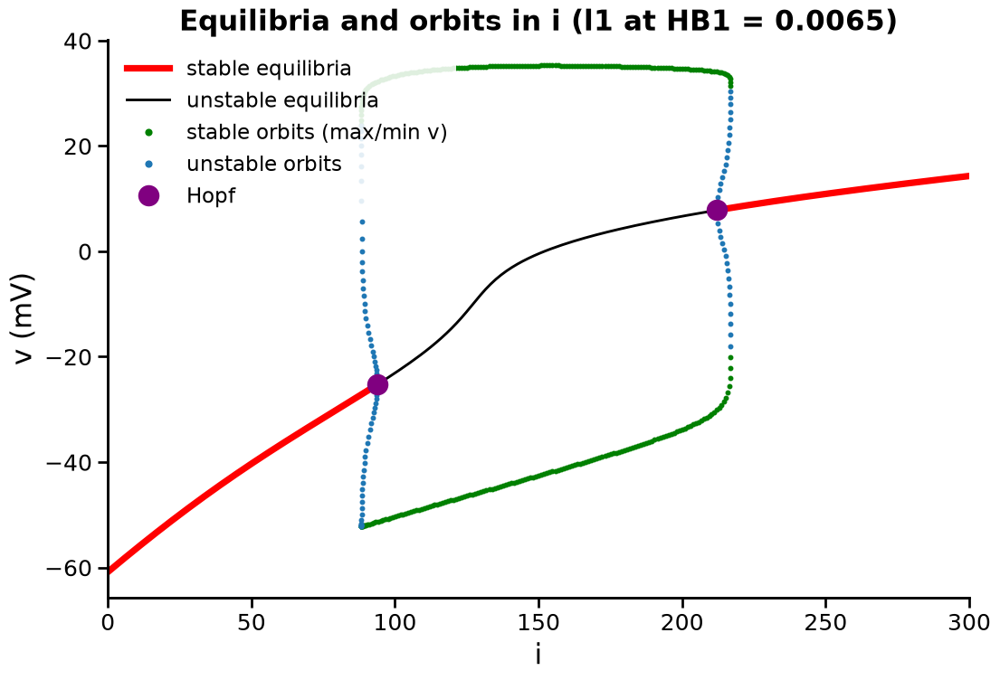
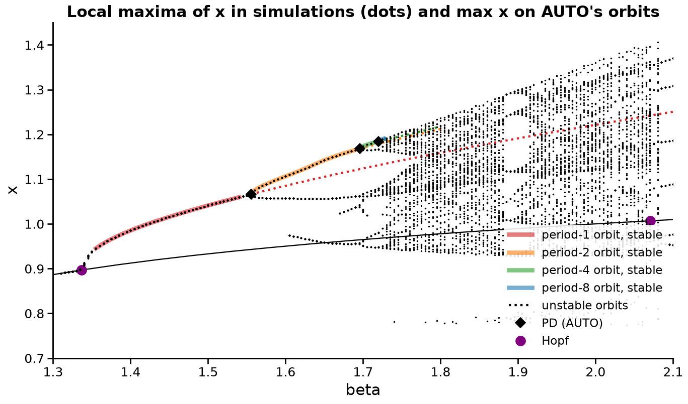

# pyauto-xpp


[](https://colab.research.google.com/github/ZetaOne/pyauto-xpp/blob/main/tutorials/worked-examples/01_first-steps.ipynb)
[](https://codespaces.new/ZetaOne/pyauto-xpp?quickstart=1)
[](https://github.com/ZetaOne/pyauto-xpp/releases/latest)
[](https://github.com/ZetaOne/pyauto-xpp/releases/latest)
[](https://github.com/ZetaOne/pyauto-xpp/releases/latest)
[](LICENSE)

[XPPAUT](https://sites.pitt.edu/~phase/bard/bardware/xpp/xpp.html) 8.4, the dynamical-systems tool by [Bard Ermentrout](https://sites.pitt.edu/~phase/), and its AUTO,
made available to Python. It is meant for batch work and Python workflows:
every XPP command is a Python call, AUTO runs from scripts, and models can be
written in Python. For interactive exploration XPPAUT itself remains the place
to go; both use the same numerics.

**→ https://zetaone.github.io/pyauto-xpp/**

```python
import pyxpp
m = pyxpp.load("lecar.ode")
tr = m.run(total=100)                       # Initialconds > Go
br = m.auto.run("iapp", start="steady")     # AUTO, from the steady state
```

<p>
  
  
</p>

*Left: Morris–Lecar in AUTO, equilibria in the applied current i (red stable,
black unstable), the two Hopf points and the periodic orbits between them
(green stable, blue unstable). Right: the Mackey–Glass delay equation, AUTO's
period doublings over the maxima of simulations. Both from the worked
examples; more in the [gallery](https://zetaone.github.io/pyauto-xpp/#gallery).*

## Features

- **The real XPPAUT 8.4**: Bard Ermentrout's C sources (in `csrc/xppaut`),
  built as a library that Python can load. Results are XPP's own.
- **Every button is a call**: Initialconds, Sing pts, nullclines, Numerics
  and the rest, as `m.buttons...`, with trajectories returned as NumPy arrays
  and AUTO's diagrams also as pandas tables.
- **AUTO from Python**: steady states, periodic orbits, one- and two-parameter
  diagrams, special points (`HB`, `LP`, `PD`, ...), **also for delay
  equations** (new in XPPAUT 8.2).
- **New in XPPAUT 8.4**: the full Lyapunov spectrum (`m.lyapunov_spectrum()`), and
  AUTO runs that keep the diagram and number their labels on (`m.auto.run(..., keep=True)`).
- **Models in Python**: `ModelBuilder` writes the `.ode` file for you, or load
  any existing `.ode` file.
- **70 tutorials**: 39 worked examples (in seven notebooks, with equations,
  explanations and checks against exact or published values), and 31 interactive notebooks with sliders, a direction
  field menu, clickable phase planes and an AUTO panel.
- **Prebuilt** for Python 3.9 to 3.15 on Linux (x86_64, ARM; glibc 2.28+),
  macOS (Apple Silicon 11+; Intel 10.9+ with Python 3.9-3.11, 10.13+ with
  3.12-3.13, 10.15+ with 3.14-3.15) and Windows (x86_64).

## Quick start

| | how | what you need |
|---|---|---|
| **In your browser** | [Open a tutorial in Google Colab](https://colab.research.google.com/github/ZetaOne/pyauto-xpp/blob/main/tutorials/worked-examples/01_first-steps.ipynb) | a Google account; the first cell installs pyauto-xpp |
| **In your browser, with GitHub** | [Open in GitHub Codespaces](https://codespaces.new/ZetaOne/pyauto-xpp?quickstart=1) | a GitHub account; uses its free monthly Codespaces hours. JupyterLab opens by itself; your work is kept until you delete the codespace |
| **uv** (recommended) | `uv run --find-links https://zetaone.github.io/pyauto-xpp/wheels/ --with pyauto-xpp --with matplotlib --with jupyterlab jupyter lab` in this folder | [uv](https://docs.astral.sh/uv/), installed once; Linux, macOS or Windows |
| **pixi** | `pixi run lab` in this folder | [pixi](https://pixi.sh), installed once |
| **pip, prebuilt** | `pip install pyauto-xpp --find-links https://zetaone.github.io/pyauto-xpp/wheels/` | Python 3.9 to 3.15 on Linux, macOS or Windows |
| **pip, from source** | `pip install .` in this folder | a C compiler |

### The editor (in your browser, running on your computer)

[The editor](https://zetaone.github.io/pyauto-xpp/editor/) on the project page
runs your code with pyauto-xpp on your own computer: Python files and notebooks (.ipynb), with tabs, folders, an arrow on the running line and a console. The first time, it shows
one install line for your system (macOS and Linux:
`curl -LsSf https://zetaone.github.io/pyauto-xpp/editor/install.sh | sh`;
Windows: a small `.bat` to download). The installer sets up uv, its own Python
in `~/.pyxpp` and the pyauto-xpp built for your machine, then starts
`pyxpp serve`; the page connects by itself, offers updates when a new version
is out, and starts it again later with one click.

To remove it: `~/.pyxpp/env/bin/pyxpp uninstall` (Windows:
`%USERPROFILE%\.pyxpp\env\Scripts\pyxpp uninstall`). That stops the server,
removes the `pyxpp://` link and `~/.pyxpp`, and keeps your files in
`~/pyxpp-work`. uv's download cache (`~/.cache/uv`; Windows `%LOCALAPPDATA%\uv`)
can be deleted too if you do not use uv otherwise.

### uv

Install [uv](https://docs.astral.sh/uv/) once (Linux and macOS:
`curl -LsSf https://astral.sh/uv/install.sh | sh`; Windows, in PowerShell:
`powershell -ExecutionPolicy ByPass -c "irm https://astral.sh/uv/install.ps1 | iex"`),
open a new terminal, and in this folder:

```
uv run --find-links https://zetaone.github.io/pyauto-xpp/wheels/ --with pyauto-xpp --with matplotlib --with jupyterlab jupyter lab
```

uv fetches Python, pyauto-xpp and the packages, and picks the right wheel for
your computer from [the wheel list](https://zetaone.github.io/pyauto-xpp/wheels/).
The first run takes a minute; after that it starts in about a second.

### pixi

Install [pixi](https://pixi.sh) once, then:

```bash
curl -fsSL https://pixi.sh/install.sh | bash   # installs pixi, once
export PATH="$HOME/.pixi/bin:$PATH"            # use it in this terminal (new terminals have it)
git clone https://github.com/ZetaOne/pyauto-xpp && cd pyauto-xpp
pixi run lab        # JupyterLab with the tutorials opens in your browser
pixi run examples   # every worked-example notebook, one line each
pixi run test       # the package's tests
```

The first run downloads Python and the packages and builds XPP's C library;
after an update, only what changed is downloaded again. No git? Download
[the .zip](https://github.com/ZetaOne/pyauto-xpp/archive/refs/heads/main.zip),
unzip it and run the same commands in that folder.

### pip

From the [Releases page](https://github.com/ZetaOne/pyauto-xpp/releases/latest),
download the wheel that matches your system and your Python
(`cp312` = Python 3.12), then:

```bash
python -m pip install pyauto_xpp-0.1.0-cp312-cp312-<your system>.whl
python -m pip install matplotlib     # for the figures in the tutorials
```

| system | the wheel's name ends in |
|---|---|
| Linux x86_64 | `x86_64.whl` |
| Linux ARM | `aarch64.whl` |
| macOS Intel (10.9+, 10.13+ or 10.15+ by Python version) | `x86_64.whl` (with `macosx`) |
| macOS Apple Silicon (11 or newer) | `arm64.whl` |
| Windows x86_64 | `win_amd64.whl` |

Or build it yourself with `python -m pip install .` in this folder (needs a C
compiler: gcc or clang).

## A first look

```python
import pyxpp
from pyxpp.builder import ModelBuilder

mb = (ModelBuilder("fhn")
      .ode("v", "v-v^3/3-w+i").ode("w", "eps*(v+a-b*w)")
      .parameter(i=0.2, a=0.7, b=0.8, eps=0.08).initial(v=-1.2, w=-0.6))
m = mb.load()
tr = m.run(total=200)                         # Initialconds > Go
m.equilibrium({"v": -1.2, "w": -0.6})         # Newton + eigenvalues
m.run(total=300); m.run_last()
d = m.auto.run("i", start="steady", ds=0.01, parmin=0, parmax=2)   # AUTO
d.special("HB")
```

The full guide is [`docs/usage/USAGE.mdx`](docs/usage/USAGE.mdx).

## Tutorials

- [`tutorials/worked-examples/`](tutorials/worked-examples): 39 worked examples in
  seven notebooks, one per level (first steps; bifurcations with AUTO; two
  parameters and global bifurcations; forcing, tori and phase; noise and space;
  delay equations by simulation and with AUTO). Each model comes with its
  equations, step-by-step explanations, figures and checks against exact or
  published values.
- [`tutorials/notebooks/`](tutorials/notebooks): interactive notebooks.
  They use `xpptut.py` from the same folder.

The [project page](https://zetaone.github.io/pyauto-xpp/#tutorials) lists
them all with a search, and a View, Download and Open in Colab link for each.

## Sister project

[**XPPAUT-Web**](https://zetaone.github.io/XPPAUT-Web/): the same XPPAUT 8.4
with its own windows, in the browser and as an Android app. Use it to click;
use pyauto-xpp to script.

## Report a bug or give feedback

[Open an issue](https://github.com/ZetaOne/pyauto-xpp/issues) on GitHub.
Please mention your system and Python version, and if a model misbehaves,
attach the `.ode` file (or the `ModelBuilder` code) and any files it uses.

## How it works

XPP's C sources are compiled into a shared library without its X11 interface
(`csrc/headless.c`, `csrc/nox11.c`), which Python loads with `ctypes`
(`pyxpp/_lib.py`). The Python side (`pyxpp/`) presses XPP's buttons and
answers its prompts for you, and reads back the trajectories, equilibria and
AUTO's diagrams. Changes are listed in [`CHANGES.md`](CHANGES.md).

## Thank you, Prof. Ermentrout

[Bard Ermentrout](https://sites.pitt.edu/~phase/)'s [XPPAUT](https://sites.pitt.edu/~phase/bard/bardware/xpp/xpp.html) and his book
[*Simulating, Analyzing, and Animating Dynamical Systems*](https://doi.org/10.1137/1.9780898718195)
have taught many of us how to explore dynamical systems. Every number in
pyauto-xpp comes from his code. Thank you, Prof. Ermentrout.

## Credits and licence

Made by [Jeevan Kumar Gochhayat](https://github.com/ZetaOne).

**GNU General Public License, version 3 or later** (GPL-3.0-or-later). See
[`LICENSE`](LICENSE).

- **[XPPAUT](https://sites.pitt.edu/~phase/bard/bardware/xpp/xpp.html)** is by [G. Bard Ermentrout](https://sites.pitt.edu/~phase/). The C sources in
  `csrc/xppaut` are his version 8.4, including AUTO for delay equations.
- **AUTO** is by E. Doedel and collaborators.
- **pyxpp**, the headless Python bridge this package grew from, is by Youngmin
  Park.
- **The tutorial models** come from the examples of [XPP Studio](https://xpp-studio.github.io/xpp-studio/) (Peter Ashwin and
  Bard Ermentrout, GPL-3.0) and from the delay-equation examples that come with
  XPPAUT 8.2.
