# pyauto-xpp: usage and examples

pyauto-xpp runs XPPAUT 8.1 and its own AUTO from Python, without the X11
window. Every example below was run with the package when this page was
built (`docs/usage/build_usage.py`); the output under each example is what it
printed, and each figure is what it saved. The import name is `pyxpp`.

## Contents

1. [Getting started](#getting-started)
2. [Writing models with ModelBuilder](#writing-models-with-modelbuilder)
3. [Parameters, initial conditions and options](#parameters-initial-conditions-and-options)
4. [Integrating and reading the data](#integrating-and-reading-the-data)
5. [Run conditions as data: `Run`](#run-conditions-as-data-run)
6. [Phase plane: nullclines, equilibria, direction fields](#phase-plane-nullclines-equilibria-direction-fields)
7. [Every XPP button from Python](#every-xpp-button-from-python)
8. [XPP's own graphics, and checking them against the data](#xpps-own-graphics-and-checking-them-against-the-data)
9. [Analysis tools in nUmerics](#analysis-tools-in-numerics)
10. [AUTO I: one-parameter diagrams](#auto-i-one-parameter-diagrams)
11. [AUTO II: two-parameter curves](#auto-ii-two-parameter-curves)
12. [AUTO III: branch points, periodic starts, period doubling, maps](#auto-iii-branch-points-periodic-starts-period-doubling-maps)
13. [AUTO IV: many initial conditions, files and buttons](#auto-iv-many-initial-conditions-files-and-buttons)
14. [Errors, limits and tips](#errors-limits-and-tips)
15. [The XPP inside: versions and what each source drop changed](#the-xpp-inside-versions-and-what-each-source-drop-changed)

## Getting started

**Build and install.** The package compiles XPP 8.1 (with AUTO) into a
shared library the first time it is built. Only a C compiler is needed;
X11 is not.

```bash
cd pyauto-xpp
python build_lib.py          # builds pyxpp/_libxpp.so
pip install -e .             # or: put pyauto-xpp on PYTHONPATH
python -m pytest tests -q    # 20 tests
```

**Load a model.** `pyxpp.load` reads an `.ode` file exactly as XPP does,
including its `@` options, `set` blocks and AUTO settings. The Morris-Lecar
file shipped with the package is used in many examples below.

```python
from pathlib import Path
import pyxpp

PKG = Path(pyxpp.__file__).resolve().parents[1]   # the pyauto-xpp folder (examples/lecar.ode is in it)

LECAR = PKG / "examples" / "lecar.ode"
m = pyxpp.load(LECAR)
print(m)
print("variables:", m.vars)
print("auxiliary:", m.aux)
print("columns of the data:", m.columns)
print("parameters:", m.par_names)
```

```text
<pyxpp.Model lecar.ode: vars=['V', 'W'] aux=['CUR', 'ICA', 'IK', 'RATE'] pars=12>
variables: ['V', 'W']
auxiliary: ['CUR', 'ICA', 'IK', 'RATE']
columns of the data: ['t', 'V', 'W', 'CUR', 'ICA', 'IK', 'RATE']
parameters: ['iapp', 'phi', 'v1', 'v2', 'v3', 'v4', 'gca', 'vk', 'vl', 'gk', 'gl', 'om']
```

Names are kept as XPP stores them (upper case), but every lookup in the
package ignores case: `m.pars["iapp"]`, `tr["v"]` and `tr["V"]` all work.

**A model from text.** `text=` takes the contents of an `.ode` file; it is
written into the model's working folder and loaded from there.

```python
vdp = pyxpp.load(text="""
# van der Pol oscillator
x'=y
y'=-x+mu*(1-x^2)*y
par mu=1
init x=2,y=0
@ total=50,dt=0.01
done
""")
print(vdp, vdp.path.name)
```

```text
<pyxpp.Model model.ode: vars=['X', 'Y'] aux=[] pars=1> model.ode
```

**Working folder.** Each model has a folder where XPP reads and writes its
files (`.set` files, AUTO's files, SVGs, ...). By default it is a new
temporary folder; `workdir=` chooses it. Every call that writes files runs
with this folder as the current directory, so relative file names land
there.

```python
from pathlib import Path

w = pyxpp.load(LECAR, workdir="lecar_work")
print(w.workdir.resolve().relative_to(Path.cwd()))
print(sorted(p.name for p in w.workdir.iterdir()))
```

```text
lecar_work
['.pyxpp']
```

**Several models at once.** Each model runs in its own private copy of the
XPP library (XPP keeps all its state in C global variables), so models in
one Python process do not interfere.

```python
m.pars["iapp"] = 0.05
print("lecar iapp =", m.pars["iapp"], "  vdp has iapp?", "iapp" in vdp.pars)
print("vdp mu =", vdp.pars["mu"], "  lecar has mu?", "mu" in m.pars)
```

```text
lecar iapp = 0.05   vdp has iapp? False
vdp mu = 1.0   lecar has mu? False
```

**XPP's messages.** By default (`quiet=True`) everything XPP and AUTO print
is collected in `m.log` instead of the terminal. `quiet=False` lets it
through.

```python
vdp.run()
print(vdp.log.strip().splitlines()[-3:])
```

```text
['Used 7 constants and 109 symbols ', 'XPPAUT 8.1.1 Copyright (C) 2002-now  Bard Ermentrout ', 'TrueColor visual:  no colormap needed']
```

**Command-line options.** `args=` passes XPP's command-line flags, e.g.
`-setfile` to read a `.set` file at start (parameters, initial data and
numerics saved by File > Write set).

```python
w.set(iapp=0.08, total=150)
w.buttons.file.write_set("start.set")   # save this state (see the buttons section)
w2 = pyxpp.load(LECAR, workdir="lecar_work", args=["-setfile", "start.set"])
print(w2.pars["iapp"], w2.numerics["total"])
```

```text
0.08 150.0
```

**Closing.** `m.close()` unloads the library copy and frees its memory. A
model that is no longer referenced is also freed.

```python
for model in (w, w2):
    model.close()
print("closed")
```

```text
closed
```

## Writing models with ModelBuilder

`ModelBuilder` writes an `.ode` file one statement at a time from Python.
Statements come out in the order the methods are called, because order
matters in an `.ode` file. `render()` shows the text, `write()` saves it,
and `load()` saves it and loads it into XPP in one step.

```python
from pyxpp.builder import ModelBuilder

ml = (ModelBuilder("lecar")
      .comment("Morris-Lecar")
      .parameter(iapp=0.1, phi=0.333)
      .parameter(v1=-0.01, v2=0.15, v3=0.1, v4=0.145, gca=1)
      .parameter(vk=-0.7, vl=-0.5, gk=2.0, gl=0.5)
      .function("minf(v)", ".5*(1+tanh((v-v1)/v2))")
      .function("ninf(v)", ".5*(1+tanh((v-v3)/v4))")
      .function("lamn(v)", "phi*cosh((v-v3)/(2*v4))")
      .fixed("ica", "gca*minf(v)*(v-1)")
      .ode("v", "iapp+gl*(vl-v)+gk*w*(vk-v)-ica")
      .ode("w", "lamn(v)*(ninf(v)-w)")
      .initial(v=-0.3, w=0)
      .aux("ica", "ica")
      .option(total=100, dt=0.05, xp="v", yp="w", xlo=-0.6, xhi=0.6, ylo=-0.1, yhi=0.6)
      .parameter_set("hopf", v3=0, v4=0.3, gca=1.1, phi=0.2)
      .tutorial("{iapp=0.1,total=200} Integrate and see the limit cycle.")
      .notes("Free text after done is ignored by XPP."))
print(ml.render())
```

```text
# Morris-Lecar
par iapp=0.1,phi=0.333
par v1=-0.01,v2=0.15,v3=0.1,v4=0.145,gca=1
par vk=-0.7,vl=-0.5,gk=2.0,gl=0.5
minf(v)=.5*(1+tanh((v-v1)/v2))
ninf(v)=.5*(1+tanh((v-v3)/v4))
lamn(v)=phi*cosh((v-v3)/(2*v4))
ica=gca*minf(v)*(v-1)
v'=iapp+gl*(vl-v)+gk*w*(vk-v)-ica
w'=lamn(v)*(ninf(v)-w)
init v=-0.3,w=0
aux ica=ica
@ total=100,dt=0.05,xp=v,yp=w,xlo=-0.6,xhi=0.6,ylo=-0.1,yhi=0.6
set hopf {v3=0,v4=0.3,gca=1.1,phi=0.2}
" {iapp=0.1,total=200} Integrate and see the limit cycle.
done
Free text after done is ignored by XPP.
```

```python
m = ml.load("lecar_built.ode")         # write + pyxpp.load
tr = m.run()
print(m, " v at the end:", round(tr["v"][-1], 4))
print("the @ options written:", ml.options())
```

```text
<pyxpp.Model lecar_built.ode: vars=['V', 'W'] aux=['ICA'] pars=11>  v at the end: -0.2687
the @ options written: {'total': '100', 'dt': '0.05', 'xp': 'v', 'yp': 'w', 'xlo': '-0.6', 'xhi': '0.6', 'ylo': '-0.1', 'yhi': '0.6'}
```

**Where the files go.** `ModelBuilder(name, outdir="output")` puts the .ode
file (`output/<name>.ode`) and XPP's working folder (its .set files, SVGs,
AUTO files) in one folder, created if missing. Without `outdir` the .ode
file goes to the current folder and each model gets a fresh temporary
working folder; `write(path)` / `load(path, workdir=...)` choose them
yourself (missing folders are created).

```python
mo = ModelBuilder("decay_out", outdir="output").ode("x", "-x").initial(x=1)
md_ = mo.load()
md_.buttons.file.write_set("run.set")
print(md_.path.parent.name, "/", md_.path.name, "  workdir:", md_.workdir.name,
      "  files:", sorted(p.name for p in md_.workdir.iterdir() if not p.name.startswith(".")))
```

```text
output / decay_out.ode   workdir: output   files: ['decay_out.ode', 'run.set']
```

**Numbers and derived quantities.** `number` is a constant that is not a
parameter; `derived` (`!name=...`) is recomputed whenever a parameter
changes; `initial_value` writes `x(0)=...`. XPP 8.1 takes a number there
for a single variable (a formula such as `exp(1)` gives 0), and a formula
in `[j]` for an array.

```python
import math

b = (ModelBuilder("decay")
     .number(k0=2)
     .parameter(tau=5)
     .derived("rate", "k0/tau")
     .ode("x", "-rate*x")
     .initial_value("x", 2.5)
     .ode("y[1..3]", "-y[j]")
     .initial_value("y[1..3]", "[j]*2")
     .option(total=5))
print(b.render())
d = b.load("decay.ode")
tr = d.run()
print("x(0) =", tr["x"][0], " x(5) =", round(float(tr["x"][-1]), 5), " exact 2.5*exp(-2) =", round(2.5 * math.exp(-2), 5))
print("y(0) =", [float(tr[f"y{i}"][0]) for i in (1, 2, 3)])
```

```text
number k0=2
par tau=5
!rate=k0/tau
x'=-rate*x
x(0)=2.5
y[1..3]'=-y[j]
y[1..3](0)=[j]*2
@ total=5
done

x(0) = 2.5  x(5) = 0.33834  exact 2.5*exp(-2) = 0.33834
y(0) = [2.0, 4.0, 6.0]
```

**Maps** (difference equations) use `map()` and the discrete method.

```python
lm = (ModelBuilder("logistic")
      .parameter(r=3.2)
      .map("x", "r*x*(1-x)")
      .initial(x=0.2)
      .option(meth="discrete", total=200))
tr = lm.load("logistic.ode").run()
print("last four iterates:", [round(float(v), 4) for v in tr["x"][-4:]], " (a 2-cycle)")
```

```text
last four iterates: [0.513, 0.7995, 0.513, 0.7995]  (a 2-cycle)
```

**Arrays.** XPP's `name[lo..hi]` notation expands to one equation per
index; `[j]` is the index as a number and `u[j]` the variable. Names that are not Python keywords are passed as
a dict.

```python
chain = (ModelBuilder("chain")
         .parameter(d=0.5)
         .ode("u[1..5]", "-u[j]+d*[j]")
         .initial({"u[1..5]": 1})
         .option(total=3))
print(chain.render())
c = chain.load("chain.ode")
print(c.vars, " u5(3) =", round(float(c.run()["u5"][-1]), 4), " exact:", round(2.5 + (1 - 2.5) * __import__("math").exp(-3), 4))
```

```text
par d=0.5
u[1..5]'=-u[j]+d*[j]
init u[1..5]=1
@ total=3
done

['U1', 'U2', 'U3', 'U4', 'U5']  u5(3) = 2.4253  exact: 2.4253
```

**Repeated blocks.** `begin_block("1..3")` ... `end_block()` repeats the
statements between them with `[j]` replaced by 1, 2, 3.

```python
blk = (ModelBuilder("blocks")
       .begin_block("1..3")
       .ode("x[j]", "-[j]*x[j]")
       .initial({"x[j]": 1})
       .end_block()
       .option(total=1))
print(blk.render())
tr = blk.load("blocks.ode").run()
print("x1, x2, x3 at t=1:", [round(float(tr[f"x{i}"][-1]), 5) for i in (1, 2, 3)],
      " exact:", [round(math.exp(-i), 5) for i in (1, 2, 3)])
```

```text
%[1..3]
x[j]'=-[j]*x[j]
init x[j]=1
%
@ total=1
done

x1, x2, x3 at t=1: [0.36788, 0.13534, 0.04979]  exact: [0.36788, 0.13534, 0.04979]
```

**Events.** `global_event(sign, condition, actions)` resets variables when
a quantity crosses zero (here an integrate-and-fire neuron).

```python
lif = (ModelBuilder("lif")
       .parameter(I=1.5, vth=1, vreset=0)
       .ode("v", "-v+I")
       .global_event(1, "v-vth", {"v": "vreset"})
       .aux("spike", "v")
       .option(total=10, dt=0.001))
tr = lif.load("lif.ode").run()
resets = tr.t[1:][tr["v"][1:] < tr["v"][:-1] - 0.5]       # v drops at each reset
print("max v =", round(float(tr["v"].max()), 4), " period:", round(float(resets[1] - resets[0]), 3),
      " exact ln(1.5/0.5) =", round(math.log(3), 3))
```

```text
max v = 1.0  period: 1.099  exact ln(1.5/0.5) = 1.099
```

**Noise and Markov chains.** `wiener` adds white noise; `markov` defines a
discrete state with transition rates (row k: rates out of state k).

```python
sde = (ModelBuilder("ou")
       .parameter(sig=0.3)
       .wiener("w")
       .ode("x", "-x+sig*w")
       .option(total=2000, dt=0.01, meth="euler"))
tr = sde.load("ou.ode").run()
print("OU: variance of x =", round(float(tr["x"][2000:].var()), 4), " theory sig^2/2 =", 0.3 ** 2 / 2)

chan = (ModelBuilder("channel")
        .parameter(a=1, b=2)
        .markov("z", [["0", "a"], ["b", "0"]])
        .ode("q", "z-q")
        .option(total=5000, dt=0.01))
tr = chan.load("channel.ode").run()
print("two-state channel: fraction open =", round(float(tr["z"].mean()), 3), " theory a/(a+b) =", round(1 / 3, 3))
```

```text
OU: variance of x = 0.047  theory sig^2/2 = 0.045
two-state channel: fraction open = 0.336  theory a/(a+b) = 0.333
```

**Tables, DAEs, integral equations, boundary conditions, special
operators.** All are written as XPP expects them:

- `table(name, n=, lo=, hi=, expr=)` a tabulated function (or `table(name, file)`);
- `algebraic` + `solve` for a differential-algebraic system;
- `volterra` for an integral equation (`int{...}`);
- `boundary` for a boundary-value problem;
- `special` for `conv`, `sparse`, `mmult`, ... ;
- `export`, `only`, `raw` for the rest.

```python
dae = (ModelBuilder("dae")
       .table("sq", n=101, lo=0, hi=2, expr="t^2")
       .ode("x", "-x+y")
       .solve("y", 1)
       .algebraic("y^3+y-x-sq(1)")
       .aux("yy", "y")                  # a solv variable is not stored; aux keeps it
       .initial(x=0)
       .option(total=2))
tr = dae.load("dae.ode").run()
y, x = tr["yy"][-1], tr["x"][-1]
print("DAE: y^3+y-x-1 at the end =", f"{y**3 + y - x - 1:.1e}")

volt = (ModelBuilder("volterra")
        .volterra("u", "1-int{exp(-t)#u}")
        .option(total=2, meth="volterra", dt=0.01))
print(volt.render())
tr = volt.load("volt.ode").run()
print("Volterra: u(2) =", round(tr["u"][-1], 5), " exact 1/2+exp(-4)/2 =", round(0.5 + 0.5 * __import__("math").exp(-4), 5))

bvp = (ModelBuilder("bvp")
       .ode("x", "y")
       .ode("y", "-x")
       .boundary("x")
       .boundary("x'-1")
       .option(total=1.5707963))
print(bvp.render())

conv = (ModelBuilder("conv")
        .table("w", n=11, lo=-5, hi=5, expr="exp(-abs(t))")
        .ode("u[0..20]", "-u[j]+k([j])")      # network values are k(0), k(1), ...
        .special("k", "conv(even,21,5,w,u0)")
        .initial({"u[0..20]": 0.1})
        .only("u0", "u10")
        .raw("# raw() writes any line as it is")
        .option(total=1))
print(conv.render())
print("loads:", conv.load("conv.ode").vars[:3], "...")
```

```text
DAE: y^3+y-x-1 at the end = 2.7e-06
volt u=1-int{exp(-t)#u}
@ total=2,meth=volterra,dt=0.01
done

Volterra: u(2) = 0.50916  exact 1/2+exp(-4)/2 = 0.50916
x'=y
y'=-x
bndry x
bndry x'-1
@ total=1.5707963
done

table w % 11 -5 5 exp(-abs(t))
u[0..20]'=-u[j]+k([j])
special k=conv(even,21,5,w,u0)
init u[0..20]=0.1
only u0,u10
# raw() writes any line as it is
@ total=1
done

loads: ['U0', 'U1', 'U2'] ...
```

**Statements written so far.** `lines` holds them; `raw_count` counts the
`raw()` lines (a model that needs `raw()` shows a gap in the builder).

```python
print(len(conv.lines), "lines, raw:", conv.raw_count, " ", repr(conv))
```

```text
7 lines, raw: 1   <ModelBuilder conv: 7 lines>
```

## Parameters, initial conditions and options

`m.pars` and `m.ics` behave like dictionaries (names in any case).

```python
from pathlib import Path
import pyxpp

PKG = Path(pyxpp.__file__).resolve().parents[1]   # the pyauto-xpp folder (examples/lecar.ode is in it)

m = pyxpp.load(PKG / "examples" / "lecar.ode")
print(m.pars)
print(m.ics)
m.pars["iapp"] = 0.08
m.ics["v"] = -0.3
m.pars.update(gca=1.1, phi=0.25)
print(m.pars["IAPP"], m.ics["V"], "gca" in m.pars, list(m.ics.keys()))
print(m.pars.as_dict()["gca"], dict(m.ics.items()))
```

```text
parameters(iapp=0, phi=0.333, v1=-0.01, v2=0.15, v3=0.1, v4=0.145, gca=1, vk=-0.7, vl=-0.5, gk=2, gl=0.5, om=1)
initial conditions(V=0, W=0)
0.08 -0.3 True ['V', 'W']
1.1 {'V': -0.3, 'W': 0.0}
```

**`set()` does all three at once**: each name is tried as a parameter,
then as a variable (initial condition), then as an `@` option, exactly as
it would be written on an `@` line.

```python
m.set(iapp=0.1, v=-0.25, w=0.05, total=250, dt=0.02, meth="rk4", maxstor=50000)
print(m.numerics)
```

```text
{'total': 250.0, 'dt': 0.02, 't0': 0.0, 'trans': 0.0, 'nout': 1, 'bound': 100.0, 'meth': 'rungekutta', 'tol': 0.001, 'atol': 0.001, 'dtmin': 1e-12, 'dtmax': 1.0, 'maxstor': 50000, 'delay': 0.0, 'newt_tol': 0.001, 'evec_tol': 0.001, 'newt_iter': 100, 'poimap': 0}
```

`set_option(name, value)` is the `@`-option part on its own; `get(name)`
reads any parameter, initial condition or derived quantity.

```python
m.set_option("bounds", 1000)
m.set_option("nout", 2)
print("bound:", m.numerics["bound"], " nout:", m.numerics["nout"], " get('phi'):", m.get("phi"), " get('v'):", m.get("v"))
```

```text
bound: 1000.0  nout: 2  get('phi'): 0.25  get('v'): -0.25
```

**Integration methods.** `meth=` takes XPP's names and some aliases:

```python
from pyxpp.model import METHODS, method_key

print(METHODS)
for name in ("rk4", "cvode", "dopri5", "stiff", "euler", "discrete", "gear", "rosen23", "symplectic"):
    m.set(meth=name)
    print(f"{name:10s} -> key {method_key(name)!r} -> {m.numerics['meth']}")
```

```text
['discrete', 'euler', 'modeuler', 'rungekutta', 'adams', 'gear', 'volterra', 'backeul', 'qualrk', 'stiff', 'cvode', '5dp', '83dp', '2rb', 'ymp']
rk4        -> key 'r' -> rungekutta
cvode      -> key 'c' -> cvode
dopri5     -> key '5' -> 5dp
stiff      -> key 's' -> stiff
euler      -> key 'e' -> euler
discrete   -> key 'd' -> discrete
gear       -> key 'g' -> gear
rosen23    -> key '2' -> 2rb
symplectic -> key 'y' -> ymp
```

**Parameter sets** written in the file as `set name {...}` are chosen with
File > Get par set (here `hopf` from `lecar.ode`).

```python
m.buttons.file.get_par_set("hopf")
print({k: m.pars[k] for k in ("v3", "v4", "gca", "phi")})
```

```text
{'v3': 0.0, 'v4': 0.3, 'gca': 1.1, 'phi': 0.2}
```

## Integrating and reading the data

`m.run()` is Initialconds > Go: it integrates from the current initial
conditions with the current numerics and returns the data browser as a
`Trajectory`. Keyword arguments go through `set()` first.

```python
import numpy as np
import matplotlib.pyplot as plt
from pathlib import Path
import pyxpp

PKG = Path(pyxpp.__file__).resolve().parents[1]   # the pyauto-xpp folder (examples/lecar.ode is in it)

m = pyxpp.load(PKG / "examples" / "lecar.ode")
tr = m.run(iapp=0.1, total=200, dt=0.05)
print(tr)
print("rows:", len(tr), " columns:", tr.names)
print("t:", tr.t[:3], "...", tr.t[-1])
print("v (any case):", tr["v"][:3], tr["V"][:3])
print("as numpy:", tr.array.shape, tr.array.dtype)
print(tr.to_pandas().describe().loc[["min", "max"]].round(4))
```

```text
<Trajectory 4001 rows x ['t', 'V', 'W', 'CUR', 'ICA', 'IK', 'RATE']>
rows: 4001  columns: ['t', 'V', 'W', 'CUR', 'ICA', 'IK', 'RATE']
t: [0.   0.05 0.1 ] ... 200.0
v (any case): [0.         0.02012537 0.0420657 ] [0.         0.02012537 0.0420657 ]
as numpy: (4001, 7) float64
         t       V       W  CUR     ICA      IK   RATE
min    0.0 -0.3817  0.0000  0.1 -0.7612  0.0000  0.333
max  200.0  0.2831  0.4274  0.1 -0.0097  0.6935  0.333
```

Auxiliary quantities (`aux` lines) are columns too. The data are what XPP
stored: single precision, every `nout`-th step, after `trans`.

```python
fig, ax = plt.subplots(1, 2, figsize=(10, 3.2))
ax[0].plot(tr.t, tr["v"], label="v")
ax[0].plot(tr.t, tr["ik"] / 10, label="ik / 10 (aux)")
ax[0].set_xlabel("t"); ax[0].legend()
ax[1].plot(tr["v"], tr["w"]); ax[1].set(xlabel="v", ylabel="w")
fig.tight_layout(); fig.savefig(FIG / "lecar_run.png", dpi=110)
```

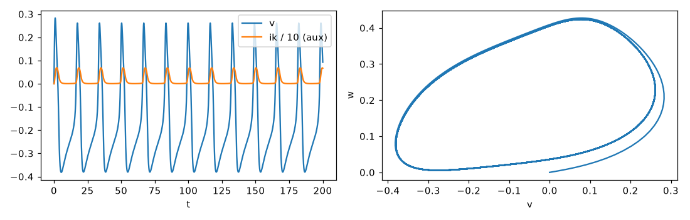

**Carrying on.**

- `run_last()`: Initialconds > Last, start again from the end of the last
  run (time starts again at `t0`);
- Initialconds > Shift: the same, but time carries on (it sets `t0`);
- `continue_run(T)`: Continue, extend the current run until time T (the
  data then hold the whole run);
- `last_point()`: the final state as a dict.

```python
a = m.run(total=50)
b = m.run_last(total=50)
print("run_last starts at the end of the last run:", np.allclose(b.array[0, 1:3], a.array[-1, 1:3]),
      " (b starts at t =", b.t[0], ")")
m.buttons.initialconds.shift()
print("shift: t from", m.data.t[0], "to", m.data.t[-1], " t0 is now", round(m.numerics["t0"], 6))
m.set(t0=0)
c = m.continue_run(120)
print("continue_run: t from", c.t[0], "to", c.t[-1])
print("last_point:", m.last_point())
```

```text
run_last starts at the end of the last run: True  (b starts at t = 0.0 )
shift: t from 50.0 to 100.0  t0 is now 50.0
continue_run: t from 50.0 to 120.0
last_point: {'V': -0.37925341725349426, 'W': 0.09480996429920197}
```

**Transient, output step and start time.** `trans` drops the first part,
`nout` stores every n-th step, `t0` sets the starting time.

```python
tr = m.run(total=100, trans=80, nout=4, t0=0)
print("first stored t:", tr.t[0], " step between rows:", tr.t[1] - tr.t[0], " rows:", len(tr))
m.set(trans=0, nout=1)
```

```text
first stored t: 80.19999694824219  step between rows: 0.20000457763671875  rows: 100
```

**Sweeps.** `sweep(name, values)` runs once per value of a parameter or an
initial condition, and puts the old value back afterwards.

```python
fig, ax = plt.subplots(figsize=(7, 3))
currents = [0.06, 0.08, 0.1, 0.2]
for I, run in zip(currents, m.sweep("iapp", currents, total=150)):
    ax.plot(run.t, run["v"], lw=1, label=f"iapp={I}")
ax.legend(fontsize=7); ax.set_xlabel("t")
fig.tight_layout(); fig.savefig(FIG / "sweep.png", dpi=110)
print("iapp after the sweep:", m.pars["iapp"])
starts = m.sweep("v", [-0.4, 0.0, 0.3], total=30, iapp=0)
print("end v from three starts:", [round(float(r["v"][-1]), 4) for r in starts])
```

```text
iapp after the sweep: 0.1
end v from three starts: [-0.4956, -0.4956, -0.4956]
```

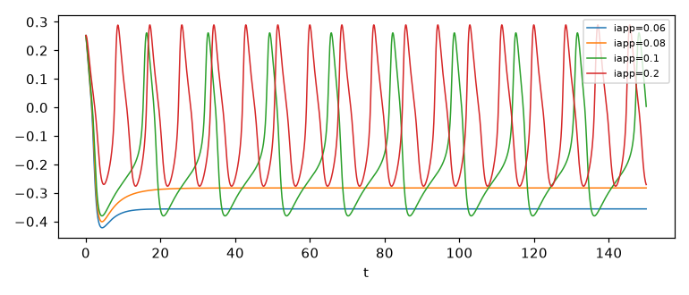

**XPP's own range integration.** Initialconds > Range (a dialog, answered
with a dict) integrates over a range in one go. With "Reset storage" = N
the runs are stored one after the other.

```python
m.set(total=40, iapp=0.0)
m.buttons.initialconds.range({"Range over": "iapp", "Steps": 4, "Start": 0.05,
                              "End": 0.25, "Reset storage (Y/N)": "N"})
print(m.transcript)
d = m.data
print("stored rows:", len(d), "= 5 runs x", len(d) // 5)
```

```text
menu    Integrate -> (R)ange
field   Range Integrate.Range over = iapp (was V)
field   Range Integrate.Steps = 4 (was 20)
field   Range Integrate.Start = 0.05 (was 0)
field   Range Integrate.End = 0.25 (was 1)
field   Range Integrate.Reset storage (Y/N) = N (was Y)

stored rows: 4005 = 5 runs x 801
```

**Other ways to start.** Initialconds > Periodic (XPP 8.1) gives exactly
one period of a stable orbit (see "Analysis tools"); New asks for each
initial value;
Backward integrates backwards in time (here it stops when `ik` passes
XPP's bound, as in the GUI).

```python
m.set(total=20, iapp=0.0)
m.buttons.initialconds.new(-0.1, 0.02)
print("new ICs:", m.ics.as_dict())
back = m.buttons.initialconds.backward()
print("backward run: t from", m.data.t[0], "to", m.data.t[-1])
```

```text
new ICs: {'V': -0.1, 'W': 0.02}
backward run: t from 0.0 to -8.449999809265137
```

**Methods compared.** A stiff solver with tolerances (CVODE through its
button, which asks for the tolerances) against fixed-step RK4.

```python
m.set(total=200, dt=0.05, iapp=0.1, v=-0.3, w=0)
rk = m.run(meth="rk4")
m.buttons.numerics.method.cvode(1e-10, 1e-10)
cv = m.run()
print(m.numerics["meth"], " largest |v_rk4 - v_cvode| =", f"{np.abs(rk['v'] - cv['v']).max():.2e}")
```

```text
cvode  largest |v_rk4 - v_cvode| = 5.23e-06
```

## Run conditions as data: `Run`

`m.run(total=..., iapp=...)` changes the model and the change stays. A
`Run` keeps *how to integrate* apart from the model: numerics, the method
and its settings, parameters, initial conditions, any other `@` option.
Applying a `Run` changes the model for that run only; afterwards it is as
it was. Fields left out keep the model's own values.

```python
from pathlib import Path
import numpy as np
import matplotlib.pyplot as plt
import pyxpp
from pyxpp import Run

PKG = Path(pyxpp.__file__).resolve().parents[1]   # the pyauto-xpp folder (examples/lecar.ode is in it)
m = pyxpp.load(PKG / "examples" / "lecar.ode")
before = m.snapshot()

base = Run(total=200, dt=0.05, meth="rk4", name="rest")
spiking = base.with_pars(iapp=0.1).with_ics(v=-0.3, w=0).replace(name="spiking")
stiff = spiking.replace(meth="cvode", tol=1e-10, atol=1e-10, name="spiking, cvode")
late = spiking.replace(trans=150, nout=4, name="spiking, last 50, every 4th step")
print(spiking)
```

```text
Run(total=200, dt=0.05, meth='rk4', pars={'iapp': 0.1}, ics={'v': -0.3, 'w': 0}, name='spiking')
```

`run_many` runs each one; every result carries the `Run` that made it.

```python
trs = m.run_many([base, spiking, stiff, late])
for t in trs:
    print(f"{t.run.name:32s} rows {len(t):5d}   t {t.t[0]:6.1f} .. {t.t[-1]:6.1f}   max v {t['v'].max():+.4f}")
print("model unchanged:", m.snapshot() == before)
print("rk4 against cvode (1e-10), largest |dv|:", f"{np.abs(trs[1]['v'] - trs[2]['v']).max():.1e}")
fig, ax = plt.subplots(figsize=(8, 3))
for t in trs:
    ax.plot(t.t, t["v"], lw=1, label=t.run.name)
ax.legend(fontsize=7); ax.set_xlabel("t"); ax.set_ylabel("v")
fig.tight_layout(); fig.savefig(FIG / "runs.png", dpi=100)
```

```text
rest                             rows  4001   t    0.0 ..  200.0   max v +0.2407
spiking                          rows  4001   t    0.0 ..  200.0   max v +0.2615
spiking, cvode                   rows  4001   t    0.0 ..  200.0   max v +0.2615
spiking, last 50, every 4th step rows   250   t  150.2 ..  200.0   max v +0.2615
model unchanged: True
rk4 against cvode (1e-10), largest |dv|: 5.2e-06
```

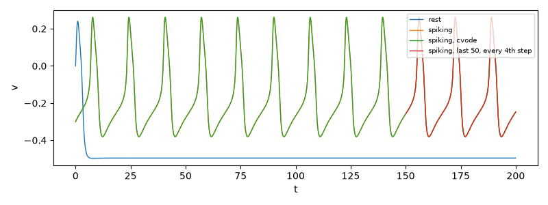

**Variants.** `replace(...)` changes fields (and replaces `pars`, `ics`,
`options` whole); `with_pars`, `with_ics`, `with_options` add to them.
`start="last"` continues from the end of the previous run (Initialconds >
Last). `Run.from_model(m)` captures the model's current settings.

```python
a = m.run(spiking)
b = m.run(spiking.replace(start="last"))
print("continues where the last run ended:", np.allclose(b.array[0, 1:3], a.array[-1, 1:3]))
print(Run.from_model(m).replace(pars={}, ics={}))
```

```text
continues where the last run ended: True
Run(total=30.0, dt=0.05, meth='rungekutta', t0=0.0, trans=0.0, nout=1, bound=100.0, tol=0.001, atol=0.001, dtmin=1e-12, dtmax=1.0, delay=0.0)
```

**One-off settings without a `Run`.** `keep=False` makes keyword settings
apply to one run only (they are sorted into parameters, initial
conditions, numerics and other options, and the result gets the `Run`);
`m.using(...)` does the same for a block of runs.

```python
t = m.run(total=50, iapp=0.1, v=-0.2, meth="cvode", keep=False)
print(t.run, " unchanged:", m.snapshot() == before)
with m.using(stiff):
    first = m.run()
    more = m.run_last()
    print("inside:", m.numerics["meth"], m.pars["iapp"])
print("after:", m.numerics["meth"], m.pars["iapp"], " unchanged:", m.snapshot() == before)
```

```text
Run(total=50, meth='cvode', pars={'iapp': 0.1}, ics={'v': -0.2})  unchanged: True
inside: cvode 0.1
after: rungekutta 0.0  unchanged: True
```

**Saving runs.** A `Run` is saved as JSON and loaded back, so a set of
runs can live next to the results it produced. (Adaptive methods store
every step: XPP sets `nout` to 1 for cvode, dopri, stiff, gear, rosen23.)

```python
p = stiff.save("runs/spiking_cvode.json")
print(p.read_text())
print("loaded back equal:", Run.load(p) == stiff)
```

```text
{
 "total": 200,
 "dt": 0.05,
 "meth": "cvode",
 "tol": 1e-10,
 "atol": 1e-10,
 "pars": {
  "iapp": 0.1
 },
 "ics": {
  "v": -0.3,
  "w": 0
 },
 "start": "ics",
 "name": "spiking, cvode"
}

loaded back equal: True
```

## Phase plane: nullclines, equilibria, direction fields

`nullclines()` asks XPP to compute the nullclines in a 2D view and returns
them as arrays of (x, y) points, with NaN rows between separate pieces.
The key is the variable whose right-hand side is zero.

```python
import numpy as np
import matplotlib.pyplot as plt
from pathlib import Path
import pyxpp

PKG = Path(pyxpp.__file__).resolve().parents[1]   # the pyauto-xpp folder (examples/lecar.ode is in it)

m = pyxpp.load(PKG / "examples" / "lecar.ode")
m.pars["iapp"] = 0.05
nc = m.nullclines(x="v", y="w", xlo=-0.6, xhi=0.5, ylo=-0.1, yhi=0.6)
print({k: a.shape for k, a in nc.items()})
```

```text
{'V': (317, 2), 'W': (180, 2)}
```

`view()` sets the 2D window on its own (Viewaxes > 2D); `mesh=` refines
the grid XPP uses for the nullclines (nUmerics > Ncline ctrl).

```python
m.view(x="v", y="w", xlo=-0.6, xhi=0.5, ylo=-0.1, yhi=0.6)
fine = m.nullclines(mesh=200)
print("points with the default mesh:", len(nc["V"]), "  with mesh=200:", len(fine["V"]))
```

```text
points with the default mesh: 317   with mesh=200: 1583
```

**Equilibria.** `equilibrium(guess)` is Newton's method (the core of
Sing pts > Go) from a guess (a dict, a sequence, or the current initial
conditions). It returns the point, its eigenvalues and its stability.
At iapp = 0.05 Morris-Lecar has three equilibria.

```python
eqs = []
for guess in ({"v": -0.4, "w": 0.0}, {"v": -0.15, "w": 0.03}, {"v": 0.0, "w": 0.3}):
    e = m.equilibrium(guess)
    eqs.append(e)
    print(e, " eigenvalues:", np.round(e.eigenvalues, 4))
```

```text
<Equilibrium stable V=-0.382505, W=0.00128554>  eigenvalues: [-0.4028+0.j -0.8904+0.j]
<Equilibrium unstable V=-0.142534, W=0.0340492>  eigenvalues: [ 1.03 +0.j -0.301+0.j]
<Equilibrium unstable V=0.0276105, W=0.269241>  eigenvalues: [0.5204+0.7811j 0.5204-0.7811j]
```

The same with the button (Sing pts > Go): XPP asks whether to print the
eigenvalues, and puts the result in the log. Sing pts > Monte Carlo
searches from many random guesses.

```python
m.ics.update(v=-0.15, w=0.03)
n = len(m.log)
m.buttons.sing_pts.go(True, False)        # print eigenvalues: yes; draw strong sets: no
print(m.transcript)
print(m.log[n:].strip())
n = len(m.log)
m.buttons.sing_pts.monte_carlo(0, 0, 200, 1e-3, -0.6, 0.5, -0.1, 0.6)
print(m.log[n:].strip())
```

```text
menu    Equilibria -> (G)o
choice  Print eigenvalues? (YES/NO) -> YES
choice  Draw Invariant Sets? (YES/NO) -> NO

Eigenvalues:
 1.029978  +  i  0.000000 
 -0.301007  +  i  0.000000
Found: 0
 x[0]= 0.0276102   eval= 0.520417 + I 0.781099 
 x[1]= 0.26924   eval= 0.520417 + I -0.781099 
Found: 1
 x[0]= -0.382505   eval= -0.402765 + I 0 
 x[1]= 0.00128561   eval= -0.890364 + I 0 
Found: 2
 x[0]= -0.142534   eval= 1.02998 + I 0 
 x[1]= 0.0340493   eval= -0.301007 + I 0
```

**Phase portrait** from these pieces, with trajectories from a few starts.

```python
fig, ax = plt.subplots(figsize=(6, 4.5))
ax.plot(*fine["V"].T, "C1", label="v' = 0")
ax.plot(*fine["W"].T, "C2", label="w' = 0")
for v0 in (-0.5, -0.3, -0.1, 0.2, 0.4):
    tr = m.run(total=150, v=v0, w=0.0)
    ax.plot(tr["v"], tr["w"], "k", lw=0.6)
for e in eqs:
    ax.plot(e.x["V"], e.x["W"], "o", color="k" if e.stable else "w", mec="k", ms=7)
ax.set(xlim=(-0.6, 0.5), ylim=(-0.1, 0.6), xlabel="v", ylabel="w", title="Morris-Lecar, iapp = 0.05")
ax.legend(fontsize=8)
fig.tight_layout(); fig.savefig(FIG / "phase_plane.png", dpi=110)
```

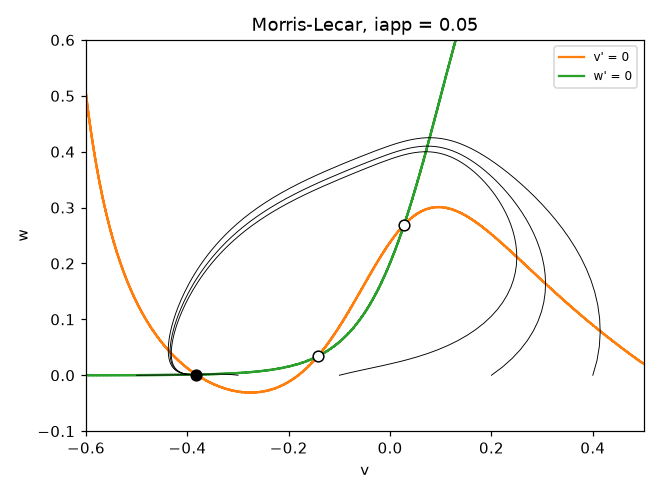

**Direction field and XPP's own picture.** Dir.field/flow draws arrows on
a grid; Graphic stuff > SVG writes the window as XPP draws it.

```python
m.buttons.dir_field.direct_field(12)
m.buttons.nullcline.new()
m.buttons.graphic_stuff.svg("pp.svg")
print("XPP wrote", (m.workdir / "pp.svg").stat().st_size, "bytes:", m.transcript.strip().splitlines()[-1])
import shutil
shutil.copy(m.workdir / "pp.svg", FIG / "xpp_phase_plane.svg")
```

```text
XPP wrote 308675 bytes: file    Print svg (*.svg) -> pp.svg
```

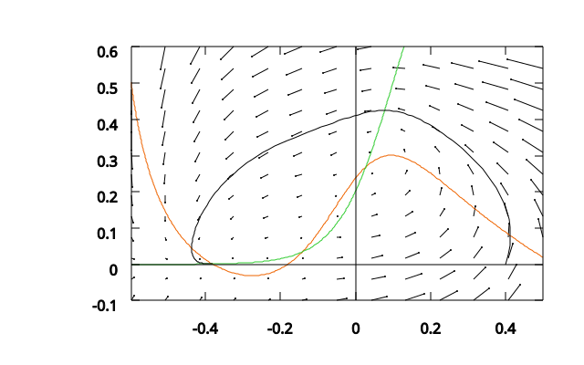

**Equilibria along a parameter** without AUTO: Sing pts > Range follows
the equilibrium found from the current initial data as a parameter
changes, and stores the results in the data browser: column `t` holds the
parameter, then the equilibrium.

```python
m.ics.update(v=-0.4, w=0.0)
m.buttons.sing_pts.range({"Range over": "iapp", "Steps": 20, "Start": 0, "End": 0.06})
d = m.data
print(d)
print("iapp, v, w:")
print(np.round(d.array[::5, :3], 5))
```

```text
<Trajectory 21 rows x ['t', 'V', 'W', 'CUR', 'ICA', 'IK', 'RATE']>
iapp, v, w:
[[ 0.0000e+00 -4.9562e-01  2.7000e-04]
 [ 1.5000e-02 -4.6349e-01  4.2000e-04]
 [ 3.0000e-02 -4.3021e-01  6.7000e-04]
 [ 4.5000e-02 -3.9496e-01  1.0800e-03]
 [ 6.0000e-02 -3.5588e-01  1.8600e-03]]
```

## Every XPP button from Python

`m.buttons` mirrors XPP's main window menu by menu, with XPP's keyboard
shortcuts; `m.auto.buttons` mirrors the AUTO window. `pyxpp.show` prints a
tree (here the start of it; the whole tree has about 230 buttons).

```python
import io
import contextlib
import warnings
from pathlib import Path
import pyxpp

PKG = Path(pyxpp.__file__).resolve().parents[1]   # the pyauto-xpp folder (examples/lecar.ode is in it)

m = pyxpp.load(PKG / "examples" / "lecar.ode")
buf = io.StringIO()
with contextlib.redirect_stdout(buf):
    pyxpp.show(m.buttons)
tree = buf.getvalue().splitlines()
print("\n".join(tree[:22]))
print(f"... {len(tree)} lines in all")
print(m.buttons.numerics.method, " ", m.buttons.numerics.method.cvode)
```

```text
initialconds           [I]  Integrate the equations
  range                  [R]  Integrate over a range of parameters, init data, etc
  two_par_range          [2]  Integrate over range of 2 parameters, init data, etc
  last                   [L]  Pick up from last step of previous solution
  old                    [O]  Use current initial data
  go                     [G]  Use current initial data
  mouse                  [M]  Specify initial data with mouse (answer: 'ix,iy' pixels)
  shift                  [S]  Pick up from last step and shift T to latest time
  new                    [N]  Input new initial data, one prompt per variable
  shoot                  [H]  Use the initial data from last shooting from fixed pt
  file                   [F]  Read init data from file
  formula                [U]  Type in function of 't' for t^th equation
  mice                   [I]  Repeated ICs using mouse
  dae_guess              [D]  Guess new values for DAE
  backward               [B]  Integrate backwards
  periodic               [P]  XPP 8.1: one period of the stable orbit, from its peak
continue_              [C]  Continue integration for specified time
nullcline              [N]  Draw nullclines
  new                    [N]  Compute new nullclines
  restore                [R]  Redraw last nullclines
  auto                   [A]  Set automatic redraw
  manual                 [M]  Only redraw when asked
... 209 lines in all
<menu 'Method': discrete, euler, mod_euler, runge_kutta, adams, gear, volterra, backeul, qualst_rk4, stiff, cvode, dopri5, dopri83, rosen23, symplectic>   <button '(C)Vode' keys=M C>
```

**Answers.** A button's positional arguments answer what XPP asks next, in
order:

| XPP asks | give |
|---|---|
| a number or text prompt | the value |
| a menu | the key letter or (the start of) the entry's label |
| a dialog with several fields | a dict `{field: value}` (fields not given keep their value) |
| a file name | the name (relative to `m.workdir`) |
| a yes/no question | `True` / `False` |

Anything not answered takes XPP's default, as if Enter were pressed.
`m.transcript` shows each question and the answer used.

```python
m.buttons.numerics.total(300)                       # a prompt
m.buttons.numerics.method("Runge")                  # a menu, by label
m.buttons.numerics.method("c", 1e-9, 1e-9)          # by key; then CVODE's tolerance prompts
print(m.transcript)
m.buttons.viewaxes.two_d({"X-axis": "v", "Y-axis": "w", "Xmin": -0.6, "Xmax": 0.5})
print(m.transcript)
```

```text
menu    Method -> (C)Vode
prompt  Relative tol: [0.001] -> 1e-09
prompt  Abs. Toler: [0.001] -> 1e-09
prompt  Banded system(0/1)? [0] -> (default)

menu    Axes -> 2D
field   2D View.X-axis = v (was V)
field   2D View.Y-axis = w (was W)
field   2D View.Xmin = -0.6 (was -0.6)
field   2D View.Xmax = 0.5 (was 1.2)
```

**Finding out what a button asks.** Press it with no answers and read the
transcript; a dialog given a wrong field name lists its fields; a menu
given a wrong entry lists its entries.

```python
m.buttons.numerics.sing_pt_ctrl()
print(m.transcript)
for call in (lambda: m.buttons.numerics.poincare_map.section({"?": 0}),
             lambda: m.buttons.numerics.method("nonsense")):
    try:
        call()
    except pyxpp.XPPError as e:
        print("XPPError:", str(e).splitlines()[0])
# A button that fails half way keeps what XPP had already done: here the
# Poincare dialog had already switched the map on, so switch it off again.
m.buttons.numerics.poincare_map.none()
```

```text
prompt  Maximum iterates : [100] -> (default)
prompt  Newton tolerance : [0.001] -> (default)
prompt  Jacobian epsilon : [0.001] -> (default)

XPPError: dialog 'Poincare map' has no field '?' (fields: 'Variable' 'Section' 'Direction (+1,-1,0)' 'Stop on sect(y/n)' )
XPPError: menu 'Method' has no entry 'nonsense' (entries: '(D)iscrete' '(E)uler' '(M)od. Euler' '(R)unge-Kutta' '(A)dams' '(G)ear' '(V)olterra' '(B)ackEul' '(Q)ualst.RK4' '(S)tiff' '(C)Vode' 'DoPri(5)' 'DoPri(8)3' 'Rosen(2)3' 'sYmplectic')
```

**Answers that were not asked for** give an `AnswersNotUsed` warning (the
button asked less than you thought).

```python
with warnings.catch_warnings(record=True) as w:
    warnings.simplefilter("always")
    m.buttons.erase("not asked")
print([str(x.category.__name__) for x in w])
```

```text
['AnswersNotUsed']
```

**Raw keys.** `m.press(key, *answers)` presses one key in the main window,
as typed in XPP; `m.press("esc")` goes back to the main menu.
`m.command(id)` runs an internal command number (`M_*` in `menudrive.h`).

```python
m.press("u")                       # open nUmerics
m.press("esc")
m.press("i", "g")                  # Initialconds > Go
print(m.transcript or "(no questions)", " rows:", len(m.data))
```

```text
menu    Integrate -> (G)o
  rows: 6001
```

**The File menu.** Save and read `.set` files (parameters, initial data,
numerics, graphics), print the source, write a readable summary, clone the
file, evaluate expressions with the calculator, change right-hand sides.
Every button that writes a file asks "File Exists! Overwrite?" when the
file is there already; without the answer `True` it keeps the old file.

```python
m.set(iapp=0.07, total=120)
m.buttons.file.write_set("run1.set")                # a new file
m.buttons.file.write_set("run1.set", True)          # it exists now: XPP asks "Overwrite?" -> True
m.set(iapp=0.0, total=30)
m.buttons.file.read_set("run1.set")
print("after read_set: iapp =", m.pars["iapp"], " total =", m.numerics["total"])

m.buttons.file.save_info("info.txt")
print((m.workdir / "info.txt").read_text().splitlines()[:8])

m.buttons.file.clone("copy_of_lecar.ode")
print("clone written:", (m.workdir / "copy_of_lecar.ode").exists())

m.buttons.file.calculator("iapp*100", "exp(1)", pyxpp.ESC)   # ESC ends the calculator
print(m.transcript)
```

```text
after read_set: iapp = 0.07  total = 120.0
['File: pyauto-xpp/examples/lecar.ode ', '', ' Equations... ', 'dV/dT=(IAPP+GL*(VL-V)+GK*W*(VK-V)-ICA)', 'dW/dT=(LAMN(V)*(NINF(V)-W))', 'CUR=IAPP', 'ICA=ICA', 'IK=GK*W*(V-VK)']
clone written: True
calc    iapp*100 = 7.000000000000001
calc    exp(1) = 2.718281828459045
```

```python
# Edit > RHS's: a dialog whose fields are dV/dT, dW/dT and the aux names;
# the model changes in place
m.buttons.file.edit.rhs({"dW/dT": "0"})
print(m.transcript.strip())
tr = m.run(total=20, v=-0.3, w=0.1)
print("w stays at 0.1 after editing w' = 0:", tr["w"].min(), tr["w"].max())
```

```text
menu    Edit Stuff -> RHS's
field   Right Hand Sides.dW/dT = 0 (was (LAMN(V)*(NINF(V)-W)))
w stays at 0.1 after editing w' = 0: 0.10000000149011612 0.10000000149011612
```

**Transcript of anything.** `m.log` holds everything XPP and AUTO printed
since loading; `m.transcript` the questions of the last call only.

```python
print(len(m.log.splitlines()), "lines in the log; last:", m.log.strip().splitlines()[-1])
```

```text
54 lines in the log; last: ICA is a duplicate name
```

## XPP's own graphics, and checking them against the data

XPP still draws everything (into an invisible window). Graphic stuff >
SVG and Postscript write what it drew, so a figure can come from XPP
itself; `pyxpp.plot` has helpers that make the matching matplotlib figure
and check that XPP's curve and the data agree to the pixel.

```python
import shutil
import matplotlib.pyplot as plt
from pathlib import Path
import pyxpp

PKG = Path(pyxpp.__file__).resolve().parents[1]   # the pyauto-xpp folder (examples/lecar.ode is in it)
from pyxpp import plot as xplot

m = pyxpp.load(PKG / "examples" / "lecar.ode")
tr = m.run(iapp=0.1, total=150)
m.buttons.xi_vs_t("v")                              # Xi vs t: plot v against t
m.buttons.window.fit()                              # Window > Fit
m.buttons.graphic_stuff.svg("v_vs_t.svg")
m.buttons.graphic_stuff.postscript({"BW-0/Color-1": 1}, "v_vs_t.ps")
print(sorted(p.name for p in m.workdir.glob("v_vs_t.*")))
shutil.copy(m.workdir / "v_vs_t.svg", FIG / "xpp_v_vs_t.svg")
```

```text
['v_vs_t.ps', 'v_vs_t.svg']
```


**More curves in one window.** Graphic stuff > Add curve adds a curve (any
columns, colour and line type); Freeze keeps the current curve when the
next run is drawn; Export data writes the numbers of the curves on the
screen.

```python
m.buttons.graphic_stuff.add_curve({"X-axis": "t", "Y-axis": "w", "Color": 2})
m.buttons.window.window({"Y Lo": -0.45, "Y Hi": 0.5})
m.buttons.graphic_stuff.export_data("curves.dat")
print((m.workdir / "curves.dat").read_text().splitlines()[:3])
m.buttons.graphic_stuff.svg("two_curves.svg")
shutil.copy(m.workdir / "two_curves.svg", FIG / "xpp_two_curves.svg")
m.buttons.graphic_stuff.remove_all()
```

```text
['0 0 0 ', '0.05 0.0201254 0.00388237 ', '0.1 0.0420657 0.00855028 ']
```

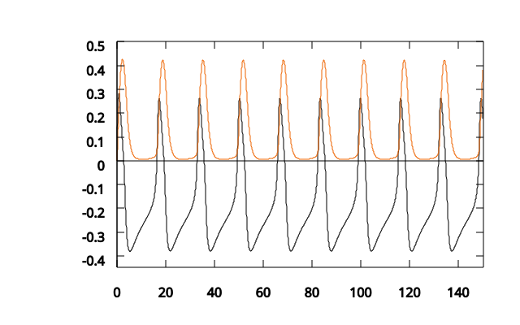

**3D views.** Viewaxes > 3D takes the axes, their ranges, and the 2D
window the projected box is drawn in (`XLo`..`YHi`, about -2..2 for the
whole box), in one dialog; 3d-params sets the viewing angles.

```python
r = pyxpp.load(text="""
x'=-y-z
y'=x+a*y
z'=b+z*(x-c)
par a=0.2,b=0.2,c=5.7
init x=1,y=1,z=0
@ total=200,dt=0.02,trans=100
done
""")
rt = r.run()
r.buttons.viewaxes.three_d({"X-axis": "x", "Y-axis": "y", "Z-axis": "z", "Xmin": -12, "Xmax": 12,
                            "Ymin": -12, "Ymax": 12, "Zmin": 0, "Zmax": 25,
                            "XLo": -2, "XHi": 2, "YLo": -2, "YHi": 2})
r.press("r")                                        # Restore: redraw
r.buttons.graphic_stuff.svg("roessler3d.svg")
shutil.copy(r.workdir / "roessler3d.svg", FIG / "xpp_roessler3d.svg")
print(r.transcript.strip().splitlines()[-1])
```

```text
file    Print svg (*.svg) -> roessler3d.svg
```


**The helpers in `pyxpp.plot`.** Each makes a matplotlib figure from XPP's
data; the `xpp_*` ones have XPP draw the same view as SVG; `compare_*`
fit XPP's drawn curve to the data and report the largest distance in
pixels (rounding to whole pixels alone gives up to about 0.5-1 px).

| helper | does |
|---|---|
| `window(tr, var)` | t range and y range with a margin |
| `plot_x_vs_t(tr, var, lim)` | one variable against t |
| `plot_all_vs_t(tr, names)` | a panel per variable |
| `plot_projection(tr, x, y)` | y against x |
| `plot_3d(tr, x, y, z)` | 3D trajectory |
| `xpp_graph(m, var, lim, path)` | XPP's own var-vs-t SVG |
| `xpp_graph2d(m, x, y, path)` / `xpp_graph3d(m, x, y, z, path)` | XPP's own 2D / 3D SVG |
| `compare_with_xpp_graph(tr, var, svg)` | pixel check for var vs t |
| `compare_curve(tr, cols, svg)` | pixel check for any 2D / 3D view |

```python
lim = xplot.window(tr, "v")
fig, ax = xplot.plot_x_vs_t(tr, "v", lim, title="v against t (matplotlib)")
fig.savefig(FIG / "mpl_v_vs_t.png", dpi=100)
svg = xplot.xpp_graph(m, "v", lim, "check_v.svg")
print("v vs t:", xplot.compare_with_xpp_graph(tr, "v", svg))

fig = xplot.plot_all_vs_t(rt, ["x", "y", "z"], title="Roessler")
fig.savefig(FIG / "mpl_all_vs_t.png", dpi=90)
fig, ax = xplot.plot_3d(rt, "x", "y", "z", title="Roessler")
fig.savefig(FIG / "mpl_3d.png", dpi=90)
svg2 = xplot.xpp_graph2d(r, "x", "y", "check_xy.svg", tr=rt)
svg3 = xplot.xpp_graph3d(r, "x", "y", "z", "check_xyz.svg", tr=rt)
c2 = xplot.compare_curve(rt, ["x", "y"], svg2)
c3 = xplot.compare_curve(rt, ["x", "y", "z"], svg3)
print("x-y view: max", round(c2["max_px"], 2), "px;  3D view: max", round(c3["max_px"], 2), "px")
```

```text
v vs t: {'xpp_points': 3001, 'data_points': 3001, 'max_px': 0.5070497799249551, 'mean_px': 0.3334538358612596, 'ok': True}
x-y view: max 0.51 px;  3D view: max 0.51 px
```

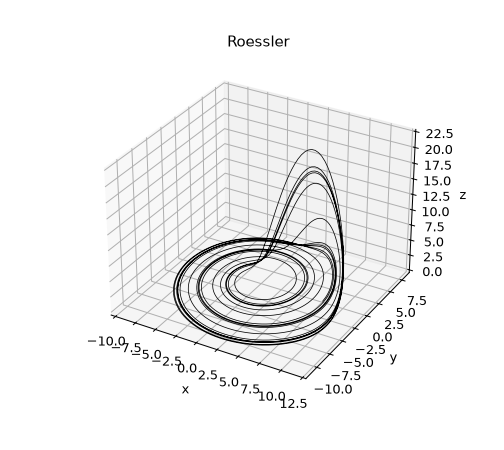

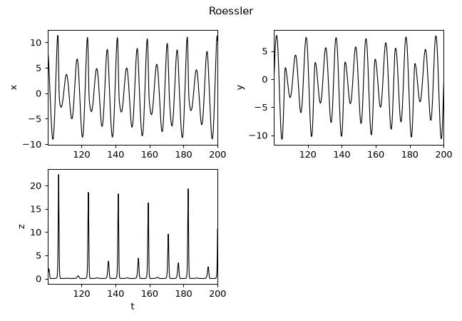

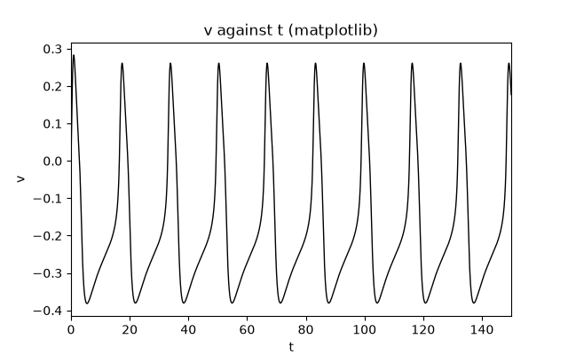

## Analysis tools in nUmerics

These buttons replace XPP's data browser with their result (a histogram,
a spectrum, an adjoint, ...). `m.data` always shows what the browser
shows; nUmerics > stocHast > Data puts the solution back.

**Statistics of a column, histogram, Fourier series.**

```python
import numpy as np
import matplotlib.pyplot as plt
from pathlib import Path
import pyxpp

PKG = Path(pyxpp.__file__).resolve().parents[1]   # the pyauto-xpp folder (examples/lecar.ode is in it)

m = pyxpp.load(PKG / "examples" / "lecar.ode")
S = m.buttons.numerics.stochast
tr = m.run(iapp=0.1, total=400, trans=200, dt=0.05)

S.stat("v")                                       # mean and standard deviation of a column
print(m.transcript.strip().splitlines()[-1], "  numpy:", round(float(tr["v"].mean()), 6), round(float(tr["v"].std()), 6))

S.histogram(50, -0.4, 0.3, "v", "")               # bins, low, high, variable, condition
h = m.data
print("histogram:", h, " columns t = bin, V = count; total count", int(h["v"].sum()))
S.data()                                          # back to the solution
S.fourier("v")
f = m.data
print("Fourier:", f, " t = frequency, V = cosine, W = sine coefficient")
k = 1 + np.argmax(np.hypot(f["v"][1:], f["w"][1:]))
print("strongest mode: frequency", round(float(f.t[k]), 5), "-> period", round(1 / float(f.t[k]), 3),
      "(frequency step 1/200: the run is 200 long)")
S.data()

fig, ax = plt.subplots(1, 2, figsize=(10, 3))
ax[0].bar(h.t, h["v"], width=0.014); ax[0].set(xlabel="v", ylabel="count", title="histogram of v")
ax[1].plot(f.t[:60], np.hypot(f["v"], f["w"])[:60], ".-"); ax[1].set(xlabel="frequency", title="|Fourier coefficient|")
fig.tight_layout(); fig.savefig(FIG / "hist_fourier.png", dpi=100)
```

```text
message Mean=-0.186542 Std. Dev. = 0.180086   numpy: -0.186542 0.180086
histogram: <Trajectory 51 rows x ['t', 'V', 'W', 'CUR', 'ICA', 'IK', 'RATE']>  columns t = bin, V = count; total count 4001
Fourier: <Trajectory 1999 rows x ['t', 'V', 'W', 'CUR', 'ICA', 'IK', 'RATE']>  t = frequency, V = cosine, W = sine coefficient
strongest mode: frequency 0.06 -> period 16.667 (frequency step 1/200: the run is 200 long)
```

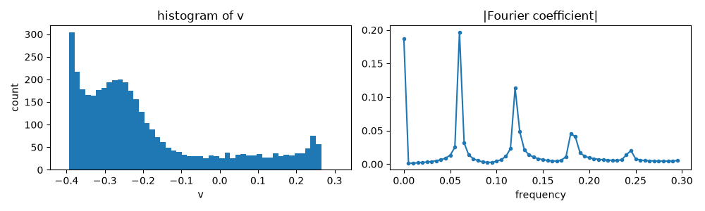

**Largest Liapunov exponent** of the current orbit (about 0 on a limit
cycle).

```python
S.liapunov(0)                                     # 0: no range over parameters
print(m.transcript.strip().splitlines()[-1])
```

```text
message Maximal exponent is -0.00223792
```

**Poincare map.** With a section set, XPP stores only the crossings
(here v = 0 going up); the times between them are the period.

```python
P = m.buttons.numerics.poincare_map
P.section({"Variable": "v", "Section": 0, "Direction (+1,-1,0)": 1})
cross = m.run(trans=0, total=300)
print(cross, " periods:", np.round(np.diff(cross.t)[-3:], 4))
P.none()
```

```text
<Trajectory 18 rows x ['t', 'V', 'W', 'CUR', 'ICA', 'IK', 'RATE']>  periods: [16.4746 16.4744 16.4745]
```

**One period of the orbit** (XPP 8.1: Initialconds > Periodic). After a
run has settled on a stable orbit, Periodic finds the period in double
precision, puts the initial condition at the peak of the plotted
variable, sets `total` to the period and `trans` to 0, and integrates one
period. This is the start that AUTO's periodic runs and the adjoint need.

```python
m.run(iapp=0.1, total=300, dt=0.01, trans=0)
m.buttons.xi_vs_t("v")                              # Periodic starts at the peak of the plotted variable
m.buttons.initialconds.periodic()
print(m.transcript.strip().splitlines()[-1])
orbit = m.data
T = m.numerics["total"]
print(f"total = {T:.6f}, trans = {m.numerics['trans']}, v(0) = {orbit['v'][0]:.6f} = max v {orbit['v'].max():.6f}")
print("XPP's note:", m.log.strip().splitlines()[-1].strip())
```

```text
message Period T=16.4745. Starting at max of V; total set to T
total = 16.474500, trans = 0.0, v(0) = 0.261500 = max v 0.261500
XPP's note: note: T / (dt*njmp) = 1647.45 is not a whole number, so the stored orbit will stop 0.0045 short of one period
```

**Adjoint and interaction function** (nUmerics > Averaging) on that one
period. XPP 8.1 closes the orbit by Newton steps, normalises the adjoint,
and also computes the isostable quantities. Make H asks for the coupling
of each equation (`v'` is the other cell's v).

```python
A = m.buttons.numerics.averaging
n = len(m.log)
A.new_adj()
adj = m.data
print(f"adjoint: {adj}, max of the V component {adj['v'].max():.4f}")
print("\n".join(l.strip() for l in m.log[n:].strip().splitlines()[-4:]))
A.make_h("v'-v", "0")                              # diffusive coupling through v
H = m.data
print("H:", H, " H(0) =", round(float(H["v"][0]), 5), "(0 for diffusive coupling: in phase, v' - v = 0)")
```

```text
adjoint: <Trajectory 401 rows x ['t', 'V', 'W', 'CUR', 'ICA', 'IK', 'RATE']>, max of the V component 58.7159
Z at phase 0: 1.9602318 3.8400032
isostable: kappa = -0.6065426415, nu = exp(kappa T) = 4.574232013e-05, next multiplier / nu = 0; I.rho = 1 to 2.4e-15, Z.rho = 0 to 7.1e-15
B found, periodic to 3.6e-17
(the grid orbit was closed by Newton steps: closure error 4.32e-09 -> 2.22e-15)
H: <Trajectory 401 rows x ['t', 'V', 'W', 'CUR', 'ICA', 'IK', 'RATE']>  H(0) = 0.0 (0 for diffusive coupling: in phase, v' - v = 0)
```

**Phase reduction to second order** (XPP 8.1, also in Averaging): the
isostable response I(t), the Floquet exponent's function rho, the
second-order phase correction B(t), and the second-order interaction
function H2 of two coupled cells. Each replaces the browser's data; H2
also reports gamma, computed two ways.

```python
curves = {"adjoint Z (V)": (adj.t, adj["v"]), "H": (H.t, H["v"])}
for name, button in (("isostable I (V)", A.isostable), ("Floquet rho (V)", A.floquet_rho),
                     ("B correction (V)", A.b_correction)):
    button()
    d = m.data
    curves[name] = (d.t.copy(), d["v"].copy())
n = len(m.log)
A.h2()
h2 = m.data
curves["H2"] = (h2.t, h2["v"])
print("\n".join(l.strip() for l in m.log[n:].strip().splitlines()))
fig, axs = plt.subplots(2, 3, figsize=(12, 5.5))
for ax, (name, (x, y)) in zip(axs.flat, curves.items()):
    ax.plot(x, y); ax.axhline(0, color="0.8", lw=0.8); ax.set_title(name, fontsize=9)
fig.tight_layout(); fig.savefig(FIG / "phase_reduction.png", dpi=100)
A.orbit()                                          # back to the orbit
```

```text
H2 computed (two coupled cells, second order): H2(0)=0, max |H2|=2.018115
g2+g3 = -2 odd(H2); gamma = (g2'(0)+g3'(0))/4 = -0.046242461 (from A: -0.046242462, from Bf: -0.046242461)
```

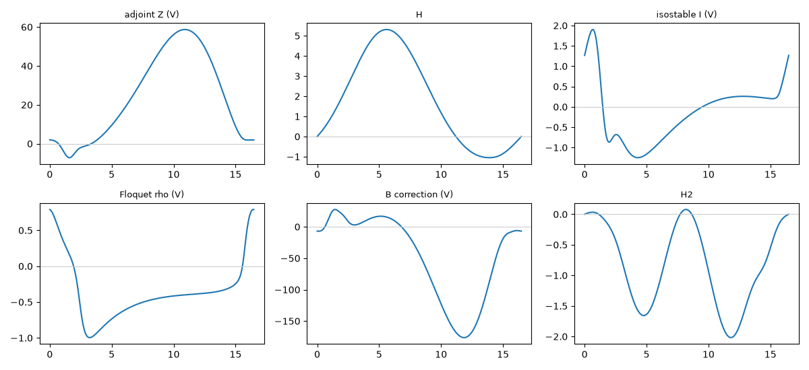

**Boundary-value problems** (Bndryval): `bndry` lines give the conditions
(`x` is the value at the start, `x'` at the end). Here x'' = -x with
x(0) = 0, x(pi/2) = 1, whose solution is sin t: the shooting finds y(0) = 1.

```python
b = pyxpp.load(text="""
x'=y
y'=-x
bndry x
bndry x'-1
init x=0,y=0.3
@ total=1.5707963,dt=0.01
done
""")
b.buttons.bndryval.show()
bt = b.data
print("y(0) =", round(float(bt["y"][0]), 6), "  x(pi/2) =", round(float(bt["x"][-1]), 6),
      "  largest |x - sin t| =", f"{np.abs(bt['x'] - np.sin(bt.t)).max():.1e}")
```

```text
y(0) = 1.0   x(pi/2) = 1.0   largest |x - sin t| = 3.4e-07
```

**Delay equations.** `delay(x, tau)` needs the maximum delay in the
`delay` option. x' = -x(t - tau) is stable for tau &lt; pi/2 and oscillates
with growing amplitude beyond.

```python
d = pyxpp.load(text="""
x'=-delay(x,tau)
par tau=1
init x=1
@ delay=5,total=60,dt=0.01
done
""")
fig, ax = plt.subplots(figsize=(7, 2.8))
for tau in (1.0, 1.5, 1.65):
    run = d.run(tau=tau)
    ax.plot(run.t, run["x"], label=f"tau = {tau}")
    print(f"tau = {tau}: |x| at the end {abs(float(run['x'][-1])):.3g}")
ax.legend(); ax.set_xlabel("t"); fig.tight_layout(); fig.savefig(FIG / "delay.png", dpi=100)
```

```text
tau = 1.0: |x| at the end 8.56e-09
tau = 1.5: |x| at the end 0.135
tau = 1.65: |x| at the end 3.92
```

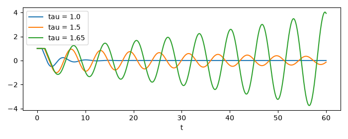

**Many noisy runs.** stocHast > Compute repeats a stochastic run (a range
dialog: here 200 runs from the same start); Mean and Variance then show
the average over the runs at each time. For dx = -x dt + 0.3 dW the
variance tends to 0.045.

```python
s = pyxpp.load(text="""
wiener w
x'=-x+0.3*w
init x=1
@ total=5,dt=0.01,meth=euler
done
""")
SS = s.buttons.numerics.stochast
SS.new_seed(12345)
SS.compute({"Range over": "x", "Steps": 200, "Start": 1, "End": 1})
SS.mean(); mean = s.data
SS.variance(); var = s.data
tt = mean.t
print("mean at t=1, 5:", round(float(mean["x"][100]), 4), round(float(mean["x"][-1]), 4), "  theory", round(np.exp(-1), 4), round(np.exp(-5), 4))
print("variance at t=5:", round(float(var["x"][-1]), 4), "  theory", round(0.045 * (1 - np.exp(-10)), 4))
```

```text
mean at t=1, 5: 0.362 0.0036   theory 0.3679 0.0067
variance at t=5: 0.0431   theory 0.045
```

## AUTO I: one-parameter diagrams

`m.auto` is XPP's own AUTO window (XPP 8.1's built-in AUTO, not
AUTO-07p). A run returns the new points as a `Diagram`; `m.auto.diagram`
is the whole diagram so far.

**Start on an equilibrium.** AUTO starts from the current initial
conditions, which must be at (or very near) an equilibrium: integrate to
rest first, then `run(param, start="steady")`. Numerics can be given in
the same call.

```python
import numpy as np
import matplotlib.pyplot as plt
from pathlib import Path
import pyxpp

PKG = Path(pyxpp.__file__).resolve().parents[1]   # the pyauto-xpp folder (examples/lecar.ode is in it)

m = pyxpp.load(PKG / "examples" / "lecar.ode")
m.pars["iapp"] = 0.0
m.run(total=300)
m.run_last(total=10)                      # sit on the equilibrium
eq = m.auto.run("iapp", start="steady", ds=0.01, dsmax=0.02, parmin=-0.2, parmax=0.5, nmax=2000)
print(eq)
for p in eq.labeled():
    print(f"  label {p.label:2d} {p.type:2s} iapp = {p.x:9.5f}  v = {p.u0['v']:8.5f}  stable: {p.stable}")
```

```text
<Diagram 67 points, labels 1:EP 2:LP 3:LP 4:HB 5:EP>
  label  1 EP iapp =   0.00000  v = -0.49562  stable: True
  label  2 LP iapp =   0.08326  v = -0.24491  stable: False
  label  3 LP iapp =  -0.02073  v = -0.03370  stable: False
  label  4 HB iapp =   0.20384  v =  0.06953  stable: False
  label  5 EP iapp =   0.51057  v =  0.12244  stable: True
```

**Periodic orbits from a Hopf point.** `grab` a labelled point and choose
what to do there; at an HB point XPP offers periodic / extend / new point
/ two param.

```python
hb = eq.special("HB")[0]
po = m.auto.run(grab=hb.label, choice="periodic", ntst=40, dsmax=0.05, nmax=400)
print(po)
lp = [p for p in po.special("LP")]
print("folds of periodic orbits at iapp =", [round(p.x, 5) for p in lp])
print("period at the last point:", round(po[-1].period, 1), " at iapp =", round(po[-1].x, 5))
```

```text
<Diagram 50 points, labels 6:LP 7:MX>
folds of periodic orbits at iapp = [0.24196]
period at the last point: 262740.2  at iapp = 0.08326
```

The orbits fold at iapp = 0.242 (the Hopf point is subcritical) and end
where their period becomes infinite, at the lower fold of equilibria
(iapp = 0.0833): a saddle-node on the orbit (SNIC). AUTO stops there and
marks the last point MX.

**The Diagram and its Points.** A `Point` has the parameter values
(`par`), the state (`u0`; for an orbit also `umax`, `umin`, `ubar`), the
period, the norm, the eigenvalues (Floquet multipliers for an orbit),
stability, the AUTO branch, point number, label and type. `par` holds
AUTO's parameter list (at most 8; see `parameters()` below).

```python
p = lp[0]
print(p.type, p.label, "branch", p.branch, "point", p.pt, " periodic:", p.periodic, " stable:", p.stable)
print("  par:", {k: round(v, 5) for k, v in p.par.items()})
print("  max v", round(p.umax["v"], 4), " min v", round(p.umin["v"], 4), " mean v", round(p.ubar["v"], 4))
print("  period", round(p.period, 4), " norm", round(p.norm, 4))
print("  multipliers:", np.round(p.eigenvalues, 4))
d = m.auto.diagram
print("whole diagram:", d, " labels", [q.label for q in d.labeled()][:6], "...")
print("label 2:", d.label(2).type, " branches:", [len(b) for b in d.branches()])
```

```text
LP 6 branch -4 point -10  periodic: True  stable: True
  par: {'iapp': 0.24196, 'phi': 0.333, 'v1': -0.01, 'v2': 0.15, 'v3': 0.1, 'v4': 0.145, 'gca': 1.0, 'vk': -0.7}
  max v 0.2556  min v -0.1432  mean v 0.0203
  period 7.4368  norm 0.3662
  multipliers: [1.+0.j 1.+0.j]
whole diagram: <Diagram 117 points, labels 1:EP 2:LP 3:LP 4:HB 5:EP 6:LP 7:MX>  labels [1, 2, 3, 4, 5, 6] ...
label 2: LP  branches: [67, 50]
```

**Tables.** `table(y)` is a numpy structured array (parameter, max and min
of `y`, stability, ...); `to_pandas(y)` the same as a DataFrame.

```python
df = d.to_pandas("v")
print(df.head(4).to_string())
print(df[df.type != ""][["label", "type", "par", "ymax", "ymin", "period", "stable", "periodic"]].round(4).to_string())
```

```text
   branch  pt  label type       par   par2      ymax      ymin      norm  period  stable  periodic
0       1   1      1   EP  0.000000  0.333 -0.495617 -0.495617  0.495617     0.0    True     False
1       1  -2      0       0.008503  0.333 -0.477514 -0.477514  0.477515     0.0    True     False
2       1  -3      0       0.016895  0.333 -0.459360 -0.459360  0.459360     0.0    True     False
3       1  -4      0       0.025147  0.333 -0.441142 -0.441142  0.441143     0.0    True     False
     label type     par    ymax    ymin       period  stable  periodic
0        1   EP  0.0000 -0.4956 -0.4956       0.0000    True     False
14       2   LP  0.0833 -0.2449 -0.2449       0.0000   False     False
29       3   LP -0.0207 -0.0337 -0.0337       0.0000   False     False
48       4   HB  0.2038  0.0695  0.0695       4.9850   False     False
66       5   EP  0.5106  0.1224  0.1224       4.7878    True     False
76       6   LP  0.2420  0.2556 -0.1432       7.4368    True      True
116      7   MX  0.0833  0.2512 -0.3965  262740.1743   False      True
```

**Plot.** `Diagram.plot(y)` draws it as XPP does: red stable / black
unstable equilibria, filled / open circles for stable / unstable orbits
(max and min of y), special points labelled.

```python
fig, ax = plt.subplots(figsize=(7, 4.5))
d.plot(y="v", ax=ax)
ax.set_title("Morris-Lecar: equilibria and periodic orbits in iapp")
fig.tight_layout(); fig.savefig(FIG / "lecar_diagram.png", dpi=110)
```

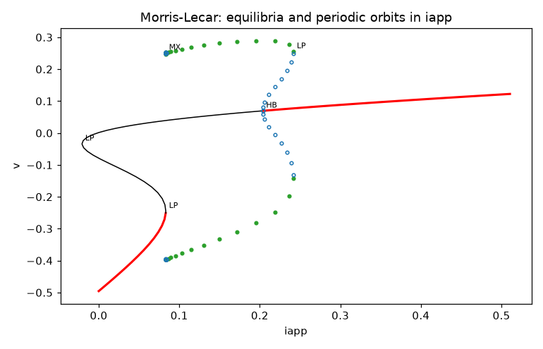

**Checked against simulation.** The stable orbit's max and min of v at
iapp = 0.1 against a long run at that current.

```python
rows = d.table("v")
stab = rows[(rows["periodic"]) & (rows["stable"])]
k = np.argmin(np.abs(stab["par"] - 0.1))
tr = m.run(iapp=stab["par"][k], total=500, trans=400, v=0, w=0.3)
print(f"iapp = {stab['par'][k]:.4f}: AUTO max/min v = {stab['ymax'][k]:.4f} / {stab['ymin'][k]:.4f};"
      f"  simulation {tr['v'].max():.4f} / {tr['v'].min():.4f}")
m.set(trans=0)
```

```text
iapp = 0.1033: AUTO max/min v = 0.2632 / -0.3772;  simulation 0.2634 / -0.3772
```

**Settings.** `settings` shows AUTO's current numerics and choices;
`numerics(...)` changes them (names as in the AutoNum dialog: ntst, nmax,
npr, ds, dsmin, dsmax, ncol, epsl, epsu, epss, parmin, parmax, normmin,
normmax, iad, mxbf, iid, itmx, itnw, nwtn, iads); `parameters(...)` sets
the list of up to 8 parameters AUTO may use; `axes(...)` the plot type
(hi, norm, hi-lo, period, two_par, frequency, average), y variable and
ranges.

```python
a = m.auto
a.numerics(ntst=60, npr=50, epsl=1e-6)
a.parameters("iapp", "gca", "phi")
a.axes("period", y="v", xmin=0, xmax=0.3)
s = a.settings
print({k: s[k] for k in ("ntst", "nmax", "npr", "ds", "dsmax", "parmin", "parmax", "epsl", "param", "y", "plot")})
print("AUTO parameters:", s["parameters"][:3])
a.axes("hi")
```

```text
{'ntst': 60, 'nmax': 400, 'npr': 50, 'ds': 0.01, 'dsmax': 0.05, 'parmin': -0.2, 'parmax': 0.5, 'epsl': 1e-06, 'param': 'iapp', 'y': 'V', 'plot': 3}
AUTO parameters: ['iapp', 'gca', 'phi']
```

## AUTO II: two-parameter curves

Grab a fold (LP) or Hopf (HB) point and continue it in two parameters.
At an LP, XPP goes straight to a two-parameter run; at an HB choose
`"two param"`. `param2=` names the second parameter. Run once with
`ds > 0` and once with `ds < 0` to get both directions along the curve.

**The cusp** x' = h + r x - x^3: folds lie on 4 r^3 = 27 h^2.

```python
import numpy as np
import matplotlib.pyplot as plt
from pathlib import Path
import pyxpp

PKG = Path(pyxpp.__file__).resolve().parents[1]   # the pyauto-xpp folder (examples/lecar.ode is in it)

cusp = pyxpp.load(text="""
x'=h+r*x-x^3
par h=-1,r=1
init x=-1
@ total=50
done
""")
cusp.run(); cusp.run_last()
br = cusp.auto.run("h", start="steady", ds=0.01, dsmax=0.05, parmin=-1, parmax=1, nmax=300)
lp = br.special("LP")[0]
print(f"fold at h = {lp.x:.6f}  (exact 2/(3 sqrt 3) = {2 / (3 * np.sqrt(3)):.6f})")
up = cusp.auto.run(grab=lp.label, param2="r", ds=0.01, nmax=300, parmin=-1, parmax=1)
down = cusp.auto.run(grab=lp.label, ds=-0.01)
for c in (up, down):
    h = np.array([p.x for p in c]); r = np.array([p.par["r"] for p in c])
    print(f"{len(c)} points, two_par={c[0].two_par}, max |4r^3 - 27h^2| = {np.abs(4 * r**3 - 27 * h**2).max():.1e}")
```

```text
fold at h = 0.384900  (exact 2/(3 sqrt 3) = 0.384900)
25 points, two_par=True, max |4r^3 - 27h^2| = 1.3e-03
76 points, two_par=True, max |4r^3 - 27h^2| = 1.2e-03
```

**Morris-Lecar in (iapp, gca):** the fold curve of equilibria and the Hopf
curve. `Diagram.plot(two_par=True)` draws the two-parameter points.

```python
m = pyxpp.load(PKG / "examples" / "lecar.ode")
m.run(total=300); m.run_last(total=10)
eq = m.auto.run("iapp", start="steady", ds=0.01, dsmax=0.02, parmin=-0.2, parmax=0.5, nmax=2000)
fold = eq.special("LP")[0]
hopf = eq.special("HB")[0]
num = dict(nmax=400, dsmax=0.02, parmin=-0.2, parmax=1.5)
f1 = m.auto.run(grab=fold.label, param2="gca", ds=0.01, **num)
f2 = m.auto.run(grab=fold.label, ds=-0.01)
h1 = m.auto.run(grab=hopf.label, choice="two param", ds=0.01)
h2 = m.auto.run(grab=hopf.label, choice="two param", ds=-0.01)
print("fold curve:", len(f1) + len(f2), "points;  Hopf curve:", len(h1) + len(h2), "points")
print("special points on them:", sorted({(p.type, round(p.x, 3), round(p.par["gca"], 3)) for p in (*f1, *f2, *h1, *h2) if p.type not in ("", "EP", "MX")}))
fig, ax = plt.subplots(1, 2, figsize=(12, 4.5))
m.auto.diagram.plot(two_par=True, ax=ax[0])          # the whole diagram, as XPP draws it
ax[0].set(xlim=(-0.2, 0.6), ylim=(0.5, 1.5), title="Diagram.plot(two_par=True)")
ax = ax[1]                                           # the same curves, coloured by kind
for c, col, lab in ((f1, "C0", "folds (LP)"), (f2, "C0", None), (h1, "C3", "Hopf (HB)"), (h2, "C3", None)):
    ax.plot([p.x for p in c], [p.par["gca"] for p in c], color=col, label=lab)
ax.plot(fold.x, 1.0, "ko", ms=4); ax.plot(hopf.x, 1.0, "ks", ms=4); ax.legend()
ax.set(xlim=(-0.2, 0.6), ylim=(0.5, 1.5), xlabel="iapp", ylabel="gca", title="Morris-Lecar in (iapp, gca)")
fig.tight_layout(); fig.savefig(FIG / "lecar_two_par.png", dpi=110)
```

```text
fold curve: 490 points;  Hopf curve: 445 points
special points on them: []
```

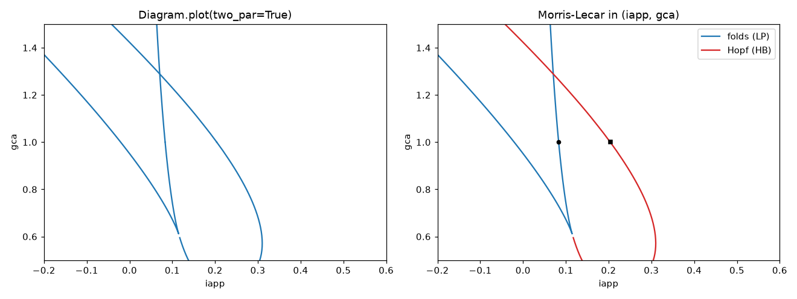

**Sub- or supercritical? GH points** (XPP 8.1, `hopf_l1.c`).
`m.auto.lyapunov(point)` gives the first Lyapunov coefficient l1 and the
frequency at a Hopf point: l1 &lt; 0 supercritical (a stable orbit is born),
l1 > 0 subcritical. In the XPP window a subcritical stretch of a Hopf
curve is drawn purple and a sign change is marked GH; headless,
`m.auto.gh_points(curve)` finds the sign changes the same way.

```python
print("Hopf at gca = 1: l1 = %.3f, omega = %.4f" % m.auto.lyapunov(hopf))
ghs = m.auto.gh_points(h1) + m.auto.gh_points(h2)
for g in ghs:
    print(f"GH at iapp = {g['par']:.4f}, gca = {g['par2']:.4f}  (l1 {g['l1_before']:+.3f} -> {g['l1_after']:+.3f})")
```

```text
Hopf at gca = 1: l1 = 17.692, omega = 1.2605
GH at iapp = 0.3082, gca = 0.6182  (l1 +0.194 -> -0.836)
GH at iapp = 0.1251, gca = 0.5534  (l1 -0.784 -> +0.216)
```

**Checked:** between the two GH points the Hopf point should be
supercritical, so the first orbits from it are stable (gca = 0.45 lies
in that stretch of the curve, which crosses it twice); at gca = 1 it is
subcritical, so they start unstable (and fold, as in section AUTO I).

```python
for gca in (1.0, 0.45):
    mm = pyxpp.load(PKG / "examples" / "lecar.ode")
    mm.pars["gca"] = gca
    mm.run(total=400); mm.run_last(total=10)
    e = mm.auto.run("iapp", start="steady", ds=0.005, dsmax=0.01, parmin=-0.2, parmax=0.5, nmax=2000)
    for h in e.special("HB"):
        l1, om = mm.auto.lyapunov(h)
        orb = mm.auto.run(grab=h.label, choice="periodic", ntst=40, ds=0.002, dsmax=0.005, nmax=8)
        print(f"gca = {gca}: Hopf at iapp = {h.x:.4f}, l1 = {l1:+8.3f};  orbits 2-6 stable: {[p.stable for p in orb[2:7]]}")
```

```text
gca = 1.0: Hopf at iapp = 0.2038, l1 =  +17.687;  orbits 2-6 stable: [False, False, False, False, False]
gca = 0.45: Hopf at iapp = 0.1542, l1 =  -44.838;  orbits 2-6 stable: [True, True, True, True, True]
gca = 0.45: Hopf at iapp = 0.2910, l1 =  -13.811;  orbits 2-6 stable: [True, True, True, True, True]
```

**The Brusselator** x' = a - (b+1) x + x^2 y, y' = b x - x^2 y: Hopf on
b = 1 + a^2.

```python
bru = pyxpp.load(text="""
x'=a-(b+1)*x+x^2*y
y'=b*x-x^2*y
par a=1,b=1
init x=1,y=1
@ total=50
done
""")
bru.run(); bru.run_last()
b1 = bru.auto.run("b", start="steady", ds=0.01, dsmax=0.05, parmin=0, parmax=5, nmax=300)
hb = b1.special("HB")[0]
print(f"Hopf at b = {hb.x:.6f} for a = 1 (exact 2)")
c1 = bru.auto.run(grab=hb.label, choice="two param", param2="a", ds=0.01, nmax=300, parmin=0, parmax=5)
c2 = bru.auto.run(grab=hb.label, choice="two param", ds=-0.01)
pts = [(p.par["a"], p.x) for p in (*c1, *c2)]
print("max |b - (1 + a^2)| on the Hopf curve:", f"{max(abs(b - 1 - a * a) for a, b in pts):.1e}")
```

```text
Hopf at b = 2.000000 for a = 1 (exact 2)
max |b - (1 + a^2)| on the Hopf curve: 5.3e-04
```

The curve is as accurate as AUTO's convergence criteria allow: with
smaller `epsl`, `epsu` (and a smaller step) it lies closer to the exact
curve. `reset()` clears the diagram first; note that grabbing points and
running leaves the parameters at the values of the last point.

```python
bru.auto.reset()
print("after the runs: a =", round(bru.pars["a"], 4), " b =", round(bru.pars["b"], 4), "(AUTO leaves the last point's values)")
bru.set(a=1, b=1, x=1, y=1)
bru.run(); bru.run_last()
tight = dict(epsl=1e-8, epsu=1e-8, epss=1e-6)
b1 = bru.auto.run("b", start="steady", ds=0.01, dsmax=0.05, parmin=0, parmax=5, nmax=300, **tight)
hb = b1.special("HB")[0]
c1 = bru.auto.run(grab=hb.label, choice="two param", param2="a", ds=0.01, dsmax=0.02, nmax=600)
c2 = bru.auto.run(grab=hb.label, choice="two param", ds=-0.01)
pts = [(p.par["a"], p.x) for p in (*c1, *c2)]
print("with epsl = epsu = 1e-8: max |b - (1 + a^2)| =", f"{max(abs(b - 1 - a * a) for a, b in pts):.1e}")
```

```text
after the runs: a = 0.0866  b = 1.0075 (AUTO leaves the last point's values)
with epsl = epsu = 1e-8: max |b - (1 + a^2)| = 9.9e-08
```

## AUTO III: branch points, periodic starts, period doubling, maps

**Branch points.** In the pitchfork x' = mu x - x^3 the trivial branch has
a branch point (BP) at mu = 0. XPP's AUTO switches branches by itself, so
one run gives the trivial branch and both new branches (x = +-sqrt(mu)).
(A BP can also be grabbed with `choice="switch"`; on this example that
only followed the trivial branch again, also with automatic switching
off, `mxbf=0`, so rely on the automatic switching.)

```python
import numpy as np
import matplotlib.pyplot as plt
import pyxpp

pf = pyxpp.load(text="""
x'=mu*x-x^3
par mu=-1
init x=0
@ total=50
done
""")
pf.run(); pf.run_last()
br = pf.auto.run("mu", start="steady", ds=0.01, dsmax=0.05, parmin=-1, parmax=1, nmax=200)
bp = br.special("BP")[0]
print(br, f"  BP at mu = {bp.x:.1e}")
for b in br.branches():
    mu = np.array([p.x for p in b]); x = np.array([p.u0["x"] for p in b])
    sel = mu > 0.01
    err = np.abs(np.abs(x[sel]) - np.sqrt(mu[sel])).max() if abs(x).max() > 0.1 else np.abs(x).max()
    print(f"  branch {b[0].branch}: {len(b)} points, mu {mu.min():.2f}..{mu.max():.2f}, error from the exact branch {err:.1e}")
```

```text
<Diagram 111 points, labels 1:EP 2:BP 3:EP 4:EP 5:EP>   BP at mu = -3.0e-09
  branch 1: 43 points, mu -1.00..1.00, error from the exact branch 0.0e+00
  branch 2: 34 points, mu -0.00..1.01, error from the exact branch 2.7e-08
  branch 2: 34 points, mu -0.00..1.01, error from the exact branch 2.7e-08
```

**Starting from a periodic orbit found by simulation** (there is no Hopf
point to start from). Integrate past the transient, measure the period,
integrate exactly one period, then `start="periodic"`: AUTO reads the
orbit and its period from the data browser. Then grab each period-doubling
point (PD) and choose `"doubling"`. Roessler system, parameter c.

```python
r = pyxpp.load(text="""
x'=-y-z
y'=x+a*y
z'=b+z*(x-c)
par a=0.2,b=0.2,c=2.5
init x=1,y=1,z=0
@ total=1000,dt=0.005,trans=900,maxstor=100000
done
""")
tr = r.run()
y, t = tr["y"], tr.t
up = np.where((y[:-1] < 0) & (y[1:] >= 0))[0]


def crossing(k):
    s = -y[k] / (y[k + 1] - y[k])
    return t[k] + s * (t[k + 1] - t[k]), {v: float(tr[v][k] + s * (tr[v][k + 1] - tr[v][k])) for v in r.vars}


t1, start = crossing(up[-2])
t2, _ = crossing(up[-1])
r.set(trans=0, total=t2 - t1, **start)
r.run()                                            # one period, starting on the section y = 0
p1 = r.auto.run("c", start="periodic", ntst=50, ds=0.01, dsmax=0.05, nmax=300, parmin=2, parmax=4.5)
pds, branch = [], p1
for k in range(3):
    if not branch.special("PD"):
        break
    pd = branch.special("PD")[0]
    pds.append(pd.x)
    print(f"PD {k + 1}: c = {pd.x:.5f}, period {pd.period:.4f}")
    branch = r.auto.run(grab=pd.label, choice="doubling", nmax=300)
print("ratio of successive PD spacings:", round((pds[1] - pds[0]) / (pds[2] - pds[1]), 3), "(Feigenbaum's limit 4.669)")
fig, ax = plt.subplots(figsize=(7, 4))
r.auto.diagram.plot(y="x", ax=ax)
ax.set(xlim=(2, 4.5), title="Roessler: period doubling in c (max and min of x)")
fig.tight_layout(); fig.savefig(FIG / "roessler_pd.png", dpi=110)
```

```text
PD 1: c = 2.83246, period 5.7698
PD 2: c = 3.83736, period 11.5727
PD 3: c = 4.12421, period 23.2026
ratio of successive PD spacings: 3.503 (Feigenbaum's limit 4.669)
```

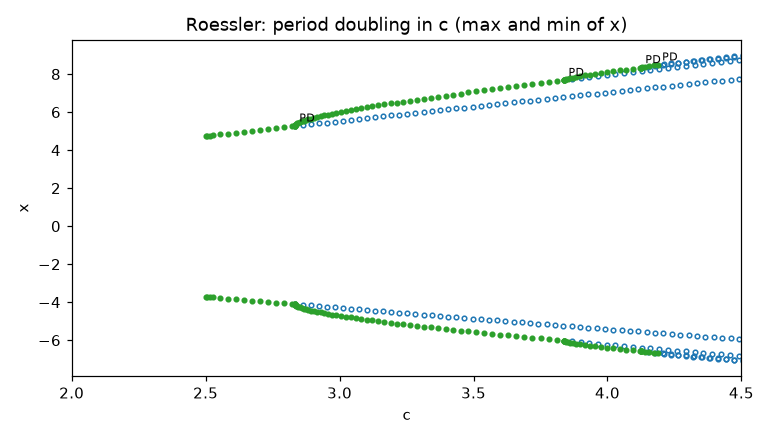

**Other choices at a point.**

| grabbed point | `choice=` |
|---|---|
| HB | `periodic`, `extend`, `new point`, `two param` |
| BP | `switch`, `extend`, `new point`, `two param` |
| LP | (none: two-parameter run) |
| PD | `doubling`, `two param`, `fixed period`, `extend` |
| TR | `two param`, `fixed period`, `extend` |
| a point on a periodic branch | `extend`, `fixed period` |

`extend` carries on from the end of a branch; `fixed period` follows the
orbit with its period held fixed in two parameters. A point is grabbed by
its label, by a `Point`, or as `"#k"` / `-1` for the k-th / last point.

```python
ext = r.auto.run(grab=p1[-1], choice="extend", nmax=50, parmax=6)
print("extend the period-1 branch past its end (c = 4.5) with parmax = 6:", len(ext),
      "more points, c up to", round(max(p.x for p in ext), 4))
```

```text
extend the period-1 branch past its end (c = 4.5) with parmax = 6: 49 more points, c up to 6.0076
```

**Maps.** For a difference equation (`meth=discrete`) AUTO follows fixed
points; a 2-cycle is a fixed point of the second iterate. Logistic map
x -> r x (1 - x): the fixed point loses stability at r = 3, where its
multiplier passes -1 (a flip). XPP labels that point HB (AUTO's type 3);
a label with no type is a regular output point (every `npr` steps).

```python
f1 = pyxpp.load(text="""
x(t+1)=r*x*(1-x)
par r=2.8
init x=0.6
@ meth=discrete,total=200
done
""")
f1.run(); f1.run_last()
m1 = f1.auto.run("r", start="steady", ds=0.01, dsmax=0.02, parmin=2.5, parmax=4, nmax=200)
print("fixed point:", [(p.type, round(p.x, 5)) for p in m1.labeled()])
print("multiplier at the HB point:", round(m1.special("HB")[0].eigenvalues[0].real, 5), " exact 2 - r =", round(2 - m1.special("HB")[0].x, 5))
f2 = pyxpp.load(text="""
f(x)=r*x*(1-x)
x(t+1)=f(f(x))
par r=3.2
init x=0.5
@ meth=discrete,total=400
done
""")
f2.run(); f2.run_last()
m2 = f2.auto.run("r", start="steady", ds=0.01, dsmax=0.02, parmin=2.9, parmax=4, nmax=200)
print("2-cycle:", [(p.type, round(p.x, 5)) for p in m2.labeled()], " (exact PD of the 2-cycle: 1 + sqrt 6 =", round(1 + 6 ** 0.5, 5), ")")
```

```text
fixed point: [('EP', 2.8), ('HB', 3.00001), ('', 3.75699), ('EP', 4.01642)]
multiplier at the HB point: -1.00001  exact 2 - r = -1.00001
2-cycle: [('EP', 3.2), ('HB', 3.4495), ('EP', 4.00122)]  (exact PD of the 2-cycle: 1 + sqrt 6 = 3.44949 )
```

## AUTO IV: many initial conditions, files and buttons

**From many initial conditions.** Integrate from each start, see where it
ends (rest or an orbit), and start AUTO there. Each start gives a branch;
they should all lie on one diagram. Hodgkin-Huxley at I = 8, where rest
and repetitive firing coexist. (The full study, 49 starts, is
`rungs/AUTO/hh/hh_auto.py`.)

```python
import numpy as np
import matplotlib.pyplot as plt
from pathlib import Path
import pyxpp

PKG = Path(pyxpp.__file__).resolve().parents[1]   # the pyauto-xpp folder (examples/lecar.ode is in it)
from pyxpp.builder import ModelBuilder

hh = (ModelBuilder("hh")
      .parameter(I=8.0, vna=50, vk=-77, vl=-54.4, gna=120, gk=36, gl=0.3, c=1)
      .function("am(v)", ".1*(v+40)/(1-exp(-(v+40)/10))")
      .function("bm(v)", "4*exp(-(v+65)/18)")
      .function("ah(v)", ".07*exp(-(v+65)/20)")
      .function("bh(v)", "1/(1+exp(-(v+35)/10))")
      .function("an(v)", ".01*(v+55)/(1-exp(-(v+55)/10))")
      .function("bn(v)", ".125*exp(-(v+65)/80)")
      .ode("v", "(I - gna*h*(v-vna)*m^3 - gk*(v-vk)*n^4 - gl*(v-vl))/c")
      .ode("m", "am(v)*(1-m) - bm(v)*m")
      .ode("h", "ah(v)*(1-h) - bh(v)*h")
      .ode("n", "an(v)*(1-n) - bn(v)*n")
      .initial(v=-65, m=0.053, h=0.596, n=0.318)
      .option(total=300, dt=0.01, meth="rk4", maxstor=100000))
m = hh.load("hh.ode")
rest = m.equilibrium({"v": -60, "m": 0.08, "h": 0.5, "n": 0.35})
starts = {"near rest": {k.lower(): x + (0.5 if k == "V" else 0) for k, x in rest.x.items()},
          "v = -40": dict(v=-40, m=0.3, h=0.3, n=0.5),
          "v = 20": dict(v=20, m=0.9, h=0.2, n=0.6)}
fig, ax = plt.subplots(1, 2, figsize=(12, 4))
for name, ic in starts.items():
    m.auto.reset()
    tr = m.run(I=8.0, trans=0, total=300, **ic)
    late = tr.t > 150
    v = tr["v"]
    ax[0].plot(tr.t, v, lw=0.8, label=name)
    if np.ptp(v[late]) < 0.5:                                   # at rest: steady state
        m.set(**{k.lower(): float(tr[k][-1]) for k in m.vars})
        d = m.auto.run("I", start="steady", ntst=15, nmax=300, npr=500, ds=0.1, dsmax=1, parmin=0, parmax=20)
        I = [p.x for p in d]; ax[1].plot(I, [p.u0["v"] for p in d], "-", label=f"{name}: equilibria")
        print(f"{name:9s} -> rest;   AUTO special points:", [(p.type, round(p.x, 4)) for p in d.labeled() if p.type == "HB"])
    else:                                                       # spiking: one period, then periodic
        up = np.where((v[:-1] < 0) & (v[1:] >= 0) & late[1:])[0]
        T = float(tr.t[up[-1]] - tr.t[up[-2]]); k = up[-2] + 1
        m.set(trans=0, total=T, **{n.lower(): float(tr[n][k]) for n in m.vars})
        m.run()
        d = m.auto.run("I", start="periodic", ntst=60, nmax=200, npr=500, ds=-0.05, dsmax=0.5, parmin=0, parmax=20)
        ax[1].plot([p.x for p in d], [p.umax["v"] for p in d], ".", ms=2, label=f"{name}: orbits (max v)")
        print(f"{name:9s} -> spiking, period {T:.3f};  folds of orbits (AUTO passes each twice):", sorted({round(p.x, 4) for p in d.labeled() if p.type == "LP"}))
ax[0].set(xlabel="t", ylabel="v", title="runs at I = 8"); ax[0].legend(fontsize=7)
ax[1].set(xlabel="I", ylabel="v", xlim=(5, 12), title="AUTO started from where each run ended"); ax[1].legend(fontsize=7)
fig.tight_layout(); fig.savefig(FIG / "hh_starts.png", dpi=100)
```

```text
near rest -> rest;   AUTO special points: [('HB', 9.7793)]
v = -40   -> spiking, period 16.020;  folds of orbits (AUTO passes each twice): [6.2642, 7.8462, 7.9217]
v = 20    -> spiking, period 16.010;  folds of orbits (AUTO passes each twice): [6.2642, 7.8462, 7.9217]
```

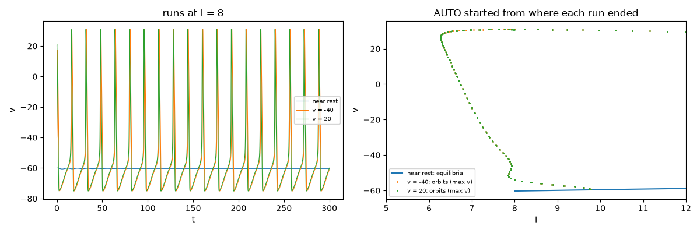

**Files.** `write_pts` writes XPP's text table of the diagram; `save` and
`load` keep a whole diagram (`.auto` file) to reload later; `reset`
deletes the diagram and AUTO's files; `clear_grab` drops the grabbed
point.

```python
lm = pyxpp.load(PKG / "examples" / "lecar.ode")
lm.run(total=300); lm.run_last(total=10)
br = lm.auto.run("iapp", start="steady", ds=0.01, dsmax=0.02, parmin=-0.2, parmax=0.5, nmax=2000)
lm.auto.write_pts("diagram.dat")
print((lm.workdir / "diagram.dat").read_text().splitlines()[:3])
lm.auto.save("lecar.auto")
n_before = len(lm.auto.diagram)
lm.auto.reset()
print("after reset:", len(lm.auto.diagram), "points")
lm.auto.load("lecar.auto")
print("after load:", len(lm.auto.diagram), "points (was", n_before, ")")
lm.auto.grab(2)
print("grabbed:", lm.auto.settings["grabbed"], " label", lm.auto.settings["grab_label"])
lm.auto.clear_grab()
print("after clear_grab:", lm.auto.settings["grabbed"])
```

```text
['0 -0.495617 -0.495617 2 1 0', '0.00850324 -0.477514 -0.477514 1 1 0', '0.0168951 -0.45936 -0.45936 1 1 0']
after reset: 0 points
after load: 67 points (was 67 )
grabbed: True  label 2
after clear_grab: False
```

**AUTO's buttons.** Everything in the AUTO window is in `m.auto.buttons`,
e.g. its own SVG of the diagram and the all-info dump.

```python
lm.auto.buttons.file.svg("diagram.svg")
print(lm.transcript.strip().splitlines()[-1])
import shutil
shutil.copy(lm.workdir / "diagram.svg", FIG / "xpp_auto_diagram.svg")
lm.auto.buttons.file.all_info("allinfo.dat")
print((lm.workdir / "allinfo.dat").read_text().splitlines()[0][:100])
```

```text
file    SVG (*.svg) -> diagram.svg
2 1 0 0 0.333 0 -0.495617 0.00027 -0.495617 0.00027 0 0 0 0 
```

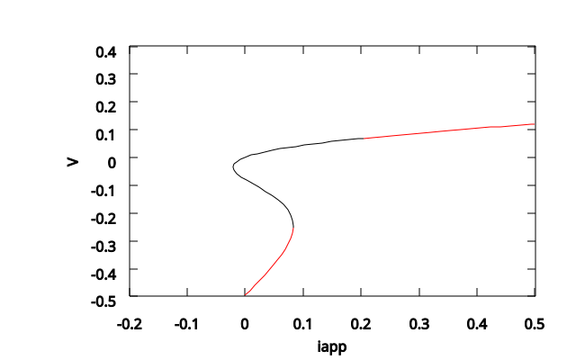

## Errors, limits and tips

**Errors.** Anything XPP refuses raises `pyxpp.XPPError` with XPP's
message (and, for a button, the transcript). XPP's `exit()` is turned
into an error, so Python keeps running; a loop that keeps asking with no
answer stops after 500 questions.

```python
from pathlib import Path
import pyxpp

PKG = Path(pyxpp.__file__).resolve().parents[1]   # the pyauto-xpp folder (examples/lecar.ode is in it)

for what, call in (
        ("a bad .ode file", lambda: pyxpp.load(text="x'=y+\ndone\n")),
        ("File > Quit", lambda: pyxpp.load(PKG / "examples" / "lecar.ode").buttons.file.quit(True)),
        ("a button that keeps asking", lambda: pyxpp.load(PKG / "examples" / "lecar.ode").buttons.file.tutorial()),
        ("an unknown parameter", lambda: pyxpp.load(PKG / "examples" / "lecar.ode").pars.__setitem__("nope", 1)),
        ("AUTO with nothing to start from", lambda: pyxpp.load(PKG / "examples" / "lecar.ode").auto.run("iapp"))):
    try:
        call()
    except (pyxpp.XPPError, KeyError, ValueError) as e:
        print(f"{what:32s} -> {type(e).__name__}: {str(e).splitlines()[0][:90]}")
```

```text
a bad .ode file                  -> XPPError: loading model.ode failed: XPP tried to exit (code 0)
File > Quit                      -> XPPError: XPP tried to exit (code 1)
a button that keeps asking       -> XPPError: XPP asked 'link to the HTML manual by setting the environment variable XPPHELP on your com
an unknown parameter             -> KeyError: "no parameter 'nope'; have ['iapp', 'phi', 'v1', 'v2', 'v3', 'v4', 'gca', 'vk', 'vl', 'gk'
AUTO with nothing to start from  -> ValueError: nothing grabbed: give start='steady' (or periodic, ...)
```

**Limits** (headless XPP):

- Buttons that need a live screen do nothing useful: Window > Scroll,
  AUTO Axes > Scroll, Viewaxes > Toon, Kinescope (blank frames).
- Mouse buttons (Initialconds > Mouse, zoom boxes, text placement) take
  pixel answers `"ix,iy"` / `"x1,y1,x2,y2"`.
- Storage is not a limit: XPP 8.1 enlarges it when a run needs more rows
  than `maxstor` (a 200 001-row run works with the default 5000).
- A crash inside XPP's C code (a segfault) ends the Python process. Run
  doubtful models in a subprocess.

**Tips.**

- Start AUTO on an equilibrium: `run()` then `run_last()` before
  `start="steady"`; for orbits, integrate exactly one period before
  `start="periodic"`.
- Writing a file that exists makes XPP ask "Overwrite?": answer `True`
  (e.g. `write_set("a.set", True)`), or the old file stays.
- Grabbing and running leaves parameters at the last point's values;
  set them again before a new start.
- To learn what a button asks, call it with no answers and read
  `m.transcript`; a wrong dialog field or menu entry lists the right ones.
- XPP stores data in single precision: compare stored values to about
  1e-7 relative.
- Every model has its own XPP; to run many in parallel, use processes
  (e.g. `concurrent.futures.ProcessPoolExecutor`), one model each.

```python
import concurrent.futures as cf


def end_v(iapp):
    m = pyxpp.load(PKG / "examples" / "lecar.ode")
    return float(m.run(iapp=iapp, total=200)["v"][-1])


with cf.ThreadPoolExecutor(1) as ex:          # (processes in real use; one thread here)
    print([round(x, 4) for x in ex.map(end_v, (0.0, 0.05, 0.1))])
```

```text
[-0.4956, -0.3825, 0.0927]
```

## The XPP inside: versions and what each source drop changed

The package carries Bard Ermentrout's XPPAUT 8.1 source (`csrc/xppaut/`),
updated as new drops arrive; `CHANGES.md` lists each one. The version XPP
reports is in the log.

```python
import time
from pathlib import Path
import pyxpp

PKG = Path(pyxpp.__file__).resolve().parents[1]   # the pyauto-xpp folder (examples/lecar.ode is in it)

m = pyxpp.load(PKG / "examples" / "lecar.ode")
print(next(l for l in m.log.splitlines() if "XPPAUT" in l).strip())
```

```text
XPPAUT 8.1.1 Copyright (C) 2002-now  Bard Ermentrout
```

| source | what changed | in pyauto-xpp |
|---|---|---|
| 8.1 (11 Nov 2026) | Initialconds > Periodic; phase reduction in Averaging (isostable I, Floquet rho, B correction, H2); subcritical Hopf curves and GH points in AUTO | `buttons.initialconds.periodic`, `buttons.numerics.averaging.isostable` / `floquet_rho` / `b_correction` / `h2` (section "Analysis tools"); `auto.lyapunov(point)` and `auto.gh_points(curve)` (section "AUTO II": XPP finds GH points while drawing, so headless they are found in Python the same way) |
| update (13 Nov 2026) | every GIF carries the model, parameters, numerics and a note; Fourier and histograms work on whatever the data browser shows (`get_browser_rows`) | `m.data` reads the browser, so the histogram, Fourier, adjoint, H come back as data (section "Analysis tools") |
| 13 Nov 2026, later | window-manager close button on every window, bevelled buttons, an X error handler, "OK"/"Close" labels; the integrator draws its progress bar and checks for Esc about 50 times a second instead of at every output point | no window, so nothing to see; results identical; same speed (below) |

**The integrator change, timed.** In the X11 GUI each progress/Esc check
flushes the X connection, so checking 50 times a second instead of at
every stored point speeds up long runs there. Headless the check is a
stub, so the speed is the same; the numbers are identical.

```python
for label, kw in (("rk4, dt = 0.05, every step stored", dict(meth="rk4", dt=0.05, nout=1)),
                  ("rk4, dt = 0.05, every 20th step stored", dict(meth="rk4", dt=0.05, nout=20))):
    best = min((lambda t0: (m.run(iapp=0.1, total=10000, v=-0.3, w=0, **kw), time.perf_counter() - t0)[1])(time.perf_counter())
               for _ in range(3))
    print(f"{label:40s} {best * 1000:6.0f} ms for {len(m.data):6d} rows, v at t = 10000: {m.data['v'][-1]:.7f}")
```

```text
rk4, dt = 0.05, every step stored           283 ms for 200001 rows, v at t = 10000: -0.2914104
rk4, dt = 0.05, every 20th step stored      234 ms for  10001 rows, v at t = 10000: -0.2914104
```
